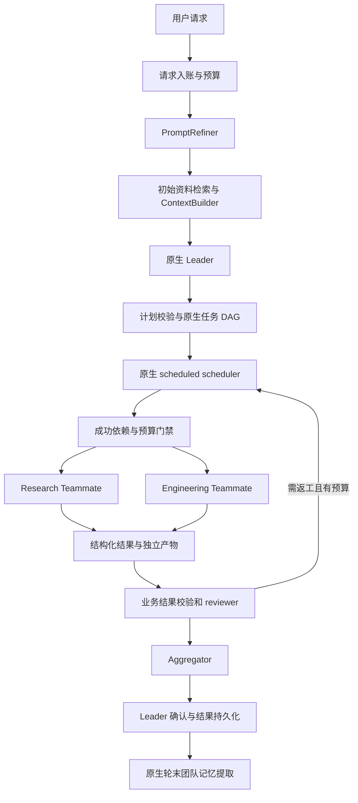

# JiuwenSwarm MVP 项目文档

版本：0.37 · 更新日期：2026-10-25（Asia/Shanghai）· 阶段：P0 全部退出条件达成（离线）；P1 工具门禁与真实回合钉子已执行（真实回合 18/18；应用建图→成员执行→结构化回传→`team.completed` 7/7）；Plan 2 在线工作台 14 个任务已落地并通过整支独立审查；**CloudBase 云托管已部署，公网链接上两个预置工作区各完成一次真实回合**（`phase=returned`、`stop_reason=team_completed`、报告 59 KB / 68 KB；部署 005）。D9–D11 已启动：冲突候选检测与面板、第二个工作区 `education-policy`、每语料独立索引已实现并通过离线断言。

本文件统一维护用户需求、工程决策、源码事实、运行流程、验收和变更记录。下一次更新前必须完整阅读本文件；新增或变更需求先记入本文，实施结束再更新实际结果。执行规则见 [AGENTS.md](AGENTS.md)。

## 1. 目标与当前状态

项目目标：基于 OpenJiuwen/JiuwenSwarm 构建可多 Agent 协作的复合型 Agent。它保留用户原始意图，先完善任务说明，再规划和分工；成员按专业角色使用 Skill、模型和工具，检索资料、管理上下文，最后形成可追溯的交付结果。

MVP 固定一个 Leader 和两个专业 Teammate（Research、Engineering）。提示词改进、上下文组装、混合检索、结果汇总是业务模块，可按需调用模型，不额外占用常驻团队成员名额。动态扩缩容与自适应模型选择属于后续目标。

| 项目项 | 当前状态 |
|---|---|
| 官方 JiuwenSwarm 源码 | 已拉取，固定到 `3fea8d1623a13646e935df9e96100ab7ad470aa4` |
| 官方 agent-core 源码 | 已拉取并切换到 Swarm 锁定的 `6df9699e650b3ad9b9835b46ae3c3b7572adb04b` |
| 源码接口核对 | 已完成 MVP 相关路径核对；不是全仓库审计 |
| 行为探针 | 7 项通过，包含 5 项隔离函数执行与 2 项静态检查 |
| P0-A 配置编译与名册校验 | 已执行：隔离 venv 内真实编译 TeamAgentSpec（11 项断言）+ Skill 可见性声明与合成（12 项断言），共 23 项通过；未启动 Runner、未调用模型、未联网 |
| P0-A Swarm 配置链 | 已执行：`load_team_spec_dict` → `TeamAgentSpec`，8 项断言通过；记录 leader desc/prompt 不透传、`enable_hitt` 默认 True 两项事实 |
| P0-B Spec 编译适配层 | 已执行：`app/config_adapter.py` 修复 leader 身份丢失（O1），19 项断言通过；应用代码首次落地 |
| P0-B Execution 账本 | 已执行：`app/execution.py`，只有当前 execution 可提交结果，14 项断言通过 |
| P0-B Dependency 门禁 | 已执行：`app/dependency.py`，取消/失败/陈旧前置不触发下游业务执行，18 项断言通过 |
| P0-B Completion 门禁 | 已执行：`app/completion.py`，坏结果/自审 reviewer/验收未过均不能完成任务，27 项断言通过 |
| P0-B PlanValidator | 已执行：`app/plan.py`，DAG 无环/依赖存在/角色有效/验收声明/关键任务须有 reviewer，20 项断言通过 |
| P0-B RunRepository | 已执行：`app/repository.py`，SQLite 持久化 run/execution/result，门禁不变式跨重启成立（含读侧），17 项断言通过 |
| P0-B RuntimeAdapter（首片） | 已执行：`app/runtime_adapter.py`，从 spec 真实构造 TeamAgent 并校验身份一致，18 项断言通过 |
| P0-C 语料索引（FTS5） | 已执行：`app/knowledge.py`，导入链 + 查询链（含短查询受限回退），22 项断言通过 |
| P0-C RRF 融合 | 已执行：`app/fusion.py`，`sum(1/(60+rank))`，11 项断言通过 |
| P0-C ContextBuilder | 已执行：`app/context.py`，预算计算、不可压缩部分、证据裁剪与估算标注，22 项断言通过 |
| P0-C 引用校验 | 已执行：`app/citations.py`，事实结论必须引用该任务实际收到的证据，15 项断言通过 |
| P0-D Aggregator | 已执行：`app/aggregator.py`，确定性模板汇总 + 覆盖/限制报告，22 项断言通过 |
| P0-D 事件投影 | 已执行：`app/events.py`，按稳定键去重登记，绝不使用接收时间，19 项断言通过 |
| P0-D 统一预算 | 已执行：`app/budget.py`，预留/结算/释放、最终汇总保留、deadline 闸门，34 项断言通过 |
| P0-E 端到端验收（离线） | 已执行：`p0e/e2e_check.py` 串联 §12 的 7 个场景，29 项断言通过；3 个场景因缺真实组件未跑 |
| P0-D 有限返工 | 已执行：`app/rework.py`，最多一次定向返工、依赖失败不返工、返工开新 execution，18 项断言通过 |
| P1 活工具集 | 已执行：`p1/live_tool_surface_check.py`，从真实构造的 team 读出 rail 自身的参数并物化 leader 工具集，对照实验证实缺口与修复，9 项断言通过 |
| P1 真实回合 | 曾经跑通：真实端点 + Runner，Leader 完成一轮（`tool_count=29`、安全 rail 与 checkpoint 均生效）；当时观察到回合末进程未执行 atexit，推断为 `os._exit()`，该机制**尚未复现**（见 §13 更正） |
| P1 工作台运行时钉子 | 已执行：应用提交 2 个已分配任务 → 原生调度器拉起成员 → 成员 `submit_task_result` → `team.completed`，7/7 通过；请求工具面无 shell/文件/spawn |
| P1 断言收集（脚本重写） | 已执行：父/子进程 + 流内定时快照 + 终止分类；`--dry-run` 8/8；真实回合 **18/18**（20 s、`returned_normally`、39 次流内快照、`tool_count=29` 对物化 10 个 team 工具、usage 14421/131）；不可达端点冒烟 12/18（非回合验收） |
| Plan 2 在线工作台（离线） | 已实现：登录会话、按运行子进程 + 原子快照、SSE、任务板投影、计划器与确定性回退、证据详情快照、单容器镜像定义、SPA 三个面板；37 个离线脚本 604 项断言全绿；整支审查的 Critical/Important 已修复 |
| Plan 2 真实模型运行（本地） | 已执行：`p1/live_product_check.py` 10/10——无预置计划，TinyAgent 真实规划 2 任务（research/engineering 各一），成员检索 6 份法规、11 条 fact 全部引用本任务检索到的证据，`team.completed`，结构化验收 complete，报告 37.9 KB；70 次模型请求无一越出工具白名单；`p1/delegation_nail.py` 复跑 7/7 |
| Plan 2 云托管部署 | **已执行**：CloudBase Run 服务 `workbench`（上海，端口 8000，PUBLIC，单实例）。部署 004 完成首次真实回合；部署 005（D9–D11 批次）后两个工作区各自通过 smoke——`ai-governance` 报告 59 KB、`education-policy` 报告 68 KB，均 `returned`/`team_completed`。**未挂持久卷**：当前凭证无 CFS 权限，且默认 VPC 无出网路由，挂卷会危及模型调用；`/data` 为实例临时层，重启后运行历史与索引重建 |
| 垂直语料内容 | 已放入 6 份公开法规原文（暂行办法 24 条、标识办法 14 条、算法推荐 35 条、深度合成 25 条、个人信息保护法 74 条、数据安全法 55 条），来源与条数见 `corpus/SOURCES.md`；离线导入 6 文档 92 块、0 失败 |
| 原对话中的 adaptive_composite_agent | 只有历史对话报告；未取得当时沙箱代码，不能据此宣称本地实现完成 |
| 应用代码、真实模型、真实 RAG、恢复测试 | 应用代码已实现；真实 RAG 检索链路离线可跑，真实模型回合见 P1 记录；恢复测试未执行 |

源码位置：`upstream/jiuwenswarm/`、`upstream/agent-core/`。版本机器记录见 [source-lock.json](source-lock.json)。当前 Swarm 包名为 `workswarm`，源码包为 `jiuwenswarm`，Python 要求 `>=3.11,<3.14`。拉取时介绍视频的 Git LFS 对象返回 404；已跳过媒体下载恢复完整源码检出，两个参考 checkout 均无本地代码变更。视频不属于本次核对范围。

## 2. 用户需求登记

来源：用户引用的《拉取分析OpenJiuwen框架》《设计JiuwenSwarm MVP》及当前会话。历史方案中的细节作为设计输入，不自动视为已验证事实。

| 编号 | 需求 | 优先级/阶段 | 验收标准 | 当前状态 |
|---|---|---|---|---|
| R01 | 使用 OpenJiuwen/JiuwenSwarm，实现多 Agent 协作 | MVP | 一个请求经 Leader 和专业成员完成 | 离线模块全部就位；**端到端流程未跑**（P1） |
| R02 | 保留一个 Leader、两个固定专业 Teammate | MVP | 名册为 3 个协作成员，执行中不能自行新增 | 已实现并按真实构造的 team 验证：leader 工具集无任何 spawn 工具；对照实验证实缺口来自 `enable_hitt` 而非 `predefined` |
| R03 | 依据 Skill 改进提示词，减少歧义和无证据推断 | MVP | 原始请求不变；约束、验收、假设、未知项分开保存 | 引用校验与 Claim 分级已实现；PromptRefiner 未做 |
| R04 | 项目规划、任务分配、依赖和必要并行 | MVP | 计划无环、依赖存在、角色有效；依赖产物通过校验才执行 | 已实现（PlanValidator + DependencyGate） |
| R05 | 不同成员使用对应 Skill | MVP | 专业可见性可检查；Skill 有版本或内容 hash；工具另行限制 | 可见性声明与合成已实现；Skill 内容 hash 与工具权限未做 |
| R06 | 上下文裁剪/摘要和压缩召回 | MVP | 长上下文仍保留硬约束和工具配对；原文可回查；模型输入不超限 | ContextBuilder 已实现；历史压缩归原生 rail，未接 |
| R07 | 知识资料 RAG 与混合检索 | MVP | 授权资料可检索、引用可回查；embedding 失效可退回关键词 | 关键词检索、RRF、引用校验已实现；向量路径与文件解析未做 |
| R08 | 最终结果汇总、覆盖检查与证据冲突处理 | MVP | 输出完整/部分/失败状态；未验证结论不标为事实 | 已实现（Aggregator；未验证 claim 改标 `[unverified]`） |
| R09 | 按角色选用匹配模型、自主调用配置的 API | MVP 基础配置；后续自适应 | 基础版角色模型可配置；记录真实调用与用量 | 接口已确认、预算账本已实现；真实模型与用量上报未接（P1） |
| R10 | 根据问题规模调整 Agent 数量 | 后续 | 按可并行任务、预算、限流决定；缩容先 draining | 已保留边界，MVP 不启用 |
| R11 | 失败回退、局部返工、预算与恢复 | MVP | 故障注入可交付明确部分结果；恢复不误重放副作用 | 门禁、Execution 账本、预算、事件投影已实现；真实恢复未接（P1） |
| R12 | 团队长期记忆、成员个人记忆和当前上下文分离 | MVP | 成员私有记忆隔离；团队提取只走框架轮末路径 | 已核对；两条记忆路径均未接入 |
| R13 | 核对源码后完善设计，不先开发整个应用 | 当前阶段 | 版本、真实接口、差异、限制均有源码证据 | 已完成；后续随实现继续核对 |
| R14 | 项目文档放入所有需求和流程；下次更新前阅读并更新 | 持续要求 | PROJECT.md 为唯一维护入口，AGENTS.md 写入规则 | 持续执行中 |
| R15 | 以本项目参加第二届全国人工智能应用创新大赛重庆区域赛（通用赛道） | 当前阶段，硬截止 2026-11-10 | 在截止前完成报名/缴费/作品提交，并在真实业务场景中产出可演示、可验证的 AI Agent 应用 | 已确认参赛意向；**应用场景与作品形态待定**，详见 §2.1 |

### 2.1 大赛约束（来源：重庆区域赛通知 PDF，2026-10-16 发布）

- 主题：“让人工智能赋能千行百业”，聚焦 AI Agent、大模型应用和真实业务场景；重点领域为教育、医疗、制造、消费、金融、出海。
- 赛道：通用赛道自主命题；“校赛—区域赛—全国总决赛”逐级晋级，不得跨级。专项赛道另行发布命题，可同时参加。
- 时间：**报名、缴费、作品提交截止 2026-11-10 24:00**；校赛 2026-11-11~11-20；区域赛 2026-11-21~12-11；总决赛 2026-12-25~12-27。
- 队伍：1–3 名队员（含 1 名队长），0–2 名指导教师，总人数 1–5；每名队员只能加入 1 支团队。
- 报名与缴费：大赛官网 <https://www.ai-race.com.cn/>；参赛费 80 元/人，由学校统一组织。
- 平台支撑：大赛以 JoyCode（<https://joycode.jd.com>）提供智能体模型调用服务。
- 评审：形式审查、会议评审、现场答辩等；具体作品要求、提交规范以官网《参赛须知》和报名系统为准。
- **对项目的影响**：内部验证（P0/P1 断言）是工程质量基础，但不能替代比赛要求的“真实业务场景 + 可演示作品”。作品需在截止前具备：明确场景与用户、可运行 demo、可复现的验收证据、方案与演示材料。场景选择待用户确认，在此之前不把工程验证当作参赛作品完成。

提示词改进只能减少歧义；降低幻觉还依赖真实检索、引用核验、工具结果记录和验收。任何模型评分都不替代这些检查。

## 3. 源码核对与原方案修正

下列事实仅适用于 source-lock.json 中的提交。Sxx 的固定源码链接见第 14 节。

| 项目 | 核对结论 | 设计影响 | 证据 |
|---|---|---|---|
| 版本兼容 | Swarm 指定 agent-core 提交，不能用最新版推测接口 | 版本锁定、升级先做兼容检查 | S01 |
| 团队入口 | `TeamAgentSpec` 与 `Runner.run_agent_team_streaming` 存在；Runner 默认接 Spec 或已激活 team_name | RuntimeAdapter 首次传 Spec，不先 build 实例再交 Runner；不使用已删除的 factory | S02、S03 |
| 固定成员 | `team_mode="predefined"` 限定名册；默认有预定义成员时仍可能为 hybrid | 必须显式 predefined；移除动态 spawn 路径 | S02 |
| 定向调度 | `dispatch_mode="scheduled"` 使用原生 scheduler；与自主 claim 模式不同 | MVP 采用 scheduled，不自建第二个任务调度器 | S02、S04 |
| 角色与模板 | `agents` 按框架 role 查找；Research/Engineering 都是 `teammate` | 在 predefined_members 的 `desc/prompt` 和可见性元数据区分专业；不能靠 `agents.research` 自动分配 | S02、S05、S06 |
| 人设字段 | 核心成员身份使用公开 `desc`、私有 `prompt` | 不只写旧 `persona`；配置编译后检查最终 Spec | S05 |
| DAG | `TeamTaskManager.add_graph` 批量原子创建、检查依赖、刷新 blocked 状态 | 通过任务工具/适配层提交图，不直接写任务表 | S04 |
| 验收开关 | `enable_task_verification` 仅影响提示词，不保证任务拥有 reviewer | 业务计划验证必须要求关键任务带 reviewer，完成还须有有效产物 | S02、S04 |
| 取消依赖 | completed 和 cancelled 都会把依赖边置为 resolved | 依赖解除不代表业务成功；执行前用成功产物门禁 | S07、P06 |
| 应用记忆 | Swarm 本地 manager 缺 key 时产生非零 mock 向量；向量故障后仍用混合权重和阈值 | 不用于 MVP 团队记忆路径；普通应用路径另加真实 provider 检查 | S08、P01、P03 |
| 团队个人记忆 | 团队 MemberMemoryToolkit 使用 core.memory.lite；无 embedding 时走关键词分支、独立阈值 | 团队记忆适配使用这条路径，不复用应用 manager 的 camelCase 参数 | S09、P02 |
| embedding 配置 | core 环境变量是 `EMBEDDING_API_KEY/BASE_URL/MODEL_NAME`；Swarm 模板另有 `EMBED_API_KEY/API_BASE/MODEL` | 配置层显式构造 EmbeddingConfig 传 TeamMemoryConfig；不假设环境变量自动互通 | S09 |
| 团队共享记忆 | SharedMemoryManager 读取 TEAM_MEMORY.md；轮末 extractor 写；它不是任意上传文件的 RAG 索引 | 作为受限上下文注入，知识资料另建索引；不重复提取 | S10 |
| 压缩器版本 | Harness 的 preset 激活 forked 压缩器，同名的传统 core 压缩器仍存在 | 按实际 Rail 的 forked 配置接入，避免同名 API 混用 | S11、P07 |
| 压缩字段 | forked 的 `min_target_context_ratio` 是可压缩片段大小下限，不是压缩到某个窗口比例 | 不承诺“达到75%必压至55%”；压缩后重新计数 | S11、P07 |
| RAG 接口 | `SimpleKnowledgeBase.add_documents/retrieve` 存在；需 chunker/indexer/store 或自定义 retriever | 明确资料导入和查询两条链；不是创建类即有完整知识库 | S12 |
| RAG 权限 | hybrid/vector/sparse 检索器调用 store 时传 `filters=None` | 不能依赖 RetrievalConfig.filters 隔离资料；先选授权 collection，再查 | S13、P04 |
| Chroma 稀疏路径 | sparse_search 使用 `collection.query(query_texts=...)`，源码也注明非直接 BM25 | MVP 关键词使用可验证的 SQLite FTS5 BM25；不把 Chroma query_texts 当 BM25 | S14 |
| Skill 可见性 | allow 并集、deny 并集；有效 allow 为空继承库；元数据损坏可退回宽松默认；配置只初始化元数据 | 所有专业成员显式非空 allow；启动验证有效集合；可见性不等于文件/工具权限 | S15、P05 |
| Swarmflow | 使用独立的一次性 worker 生命周期与并发/预算体系 | 暂不与常驻 Teammate 的任务看板混合；后续单独评估 | S16 |

### 重要限制

源码中的 CAS 状态转换不等于应用自定义 `attempt` 的完整隔离。旧结果与重新执行可能处于同一个 in_progress 状态，应用仍需给产物和结果提交增加 execution_id 校验。框架任务表和应用运行表不是天然跨库原子事务；事件发布也不能假定已经实现可靠 outbox。恢复必须对账，而不能仅重放事件。

## 4. 架构决策与职责

| 决策 | 内容 | 原因 |
|---|---|---|
| D01 | 依赖版本固定；MVP 通过薄适配层集成 JiuwenSwarm 的团队配置与 core 团队运行时 | 避免 develop 漂移 |
| D02 | 3 个协作成员、inprocess、persistent、SQLite、predefined、scheduled | 满足固定 MVP 并复用原生调度 |
| D03 | 暂不开启 Swarmflow、额外 subagent、动态 spawn、Skill 自动演进 | 保持可调试的执行路径；这些能力仍保留为后续目标 |
| D04 | 原生任务表是任务调度唯一权威；应用表只保存运行元数据、证据、产物和事件投影 | 避免双调度与双状态冲突 |
| D05 | 业务计划、结果验收与成功依赖门禁是确定性校验 | 不把完成声明当作验收通过 |
| D06 | 资料 RAG 用独立逻辑索引；小规模首版选择 SQLite FTS5 + 真实 embedding 向量排名 + RRF | 权限和 BM25 行为可验证，避免 store 差异 |
| D07 | 原生上下文 Rail 处理历史压缩；ContextBuilder 负责当前任务和证据预算 | 不给同一段历史重复做两套摘要 |
| D08 | 角色模型先静态配置；质量、延迟和成本指标稳定后再启用自适应路由 | 保留用户长期目标，先形成可评估基线 |



两个专业成员可以执行多个任务；队列任务数不等于 Agent 数。Research 提供证据和未知项；Engineering 给出架构、接口、实现建议和可执行验证。Leader 负责计划、分配、冲突处理和最终判断。Aggregator 负责结构整理和覆盖报告，不能擅自把冲突“消解”为确定事实。

## 5. 数据与存储约定

下列是应用层模型设计，不是框架已有 SDK 类型。实际实现使用 Pydantic v2；配置和业务输入采用 extra="forbid"，避免未知参数被静默忽略。

| 对象 | 关键字段 |
|---|---|
| RunRequest | run_id, session_id, user_id, project_id, original_prompt, source_refs, submitted_at, deadline_at, budget |
| TaskSpec | original_prompt_hash, goal, constraints, acceptance[id,text], assumptions, unresolved_questions, required_capabilities |
| TaskPlan | plan_id, revision, tasks[id,role,instruction,acceptance_ids,depends_on,requires_success,reviewers], source_refs |
| TaskBinding | run_id, plan_revision, app_task_id, framework_task_id, member_id, execution_id, execution_seq |
| Evidence | evidence_id, corpus, source_uri, source_revision, doc_id, chunk_id, content_hash, locator, text, retrieval_method, raw_score, fused_rank, access_scope |
| ContextBundle | spec_ref, task_ref, task_instruction, pinned_constraints, acceptance_ids, evidence, dropped_evidence_ids, fixed_overhead_tokens, input_token_estimate, tokenizer_id |
| TaskResult | task_id, execution_id, outcome[success/partial/error], claims[text,kind,evidence_ids], artifact_refs, acceptance_checks, unresolved, error |
| Artifact | artifact_id, run_id, task_id, execution_id, path, hash, media_type, created_at |
| AcceptanceCheck | acceptance_id, result[pass/fail/unknown], verifier, evidence_refs, diagnostic |
| RunEvent | event_id, seq, run_id, session_id, framework_event_ref, entity_id, dedup_key, type, payload_ref, observed_at |
| FinalResult | run_id, outcome[complete/partial/failed/cancelled], answer, acceptance_checks, evidence_refs, artifact_refs, limitations, usage |
| Budget | max_model_calls, max_tokens, deadline_at, spent, reserved, finalization_reserve, usage_quality[provider/estimated/unknown] |

原生任务状态按框架展示：pending、blocked、planning、in_progress、in_review、completed、cancelled。应用不得把自定义 failed/succeeded 状态直接写入原生表。应用 `outcome` 记录业务结果，即使 framework_task 已 completed，也必须经过 AcceptanceCheck 才能视为业务成功。

ContextBundle 的字段以 [app/context.py](app/context.py) 的实现为准（上表已同步）。原设计中的 `decision_refs` / `recent_messages` / `compressed_history_ref` **未实现**：历史与压缩归框架原生上下文 rail（§7.1、D07），应用只组装当前任务与证据；`evidence_refs` 改为直接携带 `Evidence` 对象，`dropped_evidence_ids` 与 `fixed_overhead_tokens` 为实现新增——前者让被裁剪的上下文可自查，后者承载系统提示词/Skill/tool schema/历史等应用无法测量的固定开销。

运行状态、知识、长期记忆分别保存：

```text
project-data/
├── runs.sqlite                    # 请求、预算、结果、绑定、事件投影
├── knowledge/<project>/<scope>/    # 授权语料和独立 FTS/vector 索引
│   ├── corpus.sqlite
│   └── sources/                    # 原始资料及版本/hash
└── runs/<run_id>/tasks/<task_id>/<execution_id>/
    ├── result.json
    └── artifacts/                  # 不可变产物，不覆盖旧执行
```

原生团队任务/消息/会话 checkpoint 保持框架拥有。个人记忆由当前成员读取、写入；共享 TEAM_MEMORY.md 由框架 extractor 更新。它记录团队决策/经验，不替代当前运行账本或资料源。团队记忆作为稳定背景，事实仍回查原资料。

事件消费采用去重投影：同一框架事件重复到达不重复登记；框架没稳定 event_id 的事件，使用已知实体标识和转换数据形成去重键，不能按接收时间生成“唯一新事件”。定期/恢复时读取原生任务快照重建投影，处理丢失事件。MVP 同一个 team_name/session 同时只承载一个业务 run；跨会话并行采用独立 team_name，避免原生 pool 的 team_name 单 Leader 语义冲突。

## 6. 完整执行流程

1. **请求入账**：生成 run_id、绑定 session/team；保存原始请求及 hash；设定预算与截止时间。资料作为输入数据，不成为系统指令。
2. **提示词改进**：PromptRefiner 使用选定的提示词工程 Skill 内容，生成 TaskSpec。推测只写 assumptions，不补造用户目标。必须问题缺失时进入 needs_input，允许继续的未知项明确保留。
3. **初始检索**：只访问该身份授权的资料 scope；读取本团队共享记忆与 Leader 自身个人记忆。Leader 不统一搜索全成员私有记忆。
4. **Leader 规划**：产出结构化 TaskPlan；Validator 检查 DAG、身份、角色、依赖引用、验收覆盖、预算和 reviewer。无效计划修复一次，仍失败使用最小固定模板。
5. **创建原生任务**：RuntimeAdapter 将计划映射到原生 create_task 批量工具/TeamTaskManager.add_graph 的内部桥接；用原生 scheduler 启动成员，不另建 claim/lease 循环。
6. **执行前门禁**：TaskInputRail/工具桥接在任何子任务业务模型或工具执行前读取前置 TaskResult；需要成功的边须有当前 execution 的有效产物。失败边进入应用 dependency_failed，交回 Leader 调整/取消子图，不能因 framework resolved 而继续。
7. **子任务检索与上下文组装**：定向检索；固定目标、硬约束、验收、当前任务和必要证据；历史交给原生 ContextProcessorRail。任务输入和引用带版本。
8. **专业成员执行**：使用当前成员的显式 Skill 集合、模型和工具范围。模型/工具调用留记录，产物写入该 execution 独立目录。
9. **提交结果**：新增 submit_task_result 工具校验 JSON、引用、产物 hash 与 execution_id，保存不可变结果。只有当前 execution 可以触发 member_complete_task；绕过提交工具的完成请求由 CompletionGateRail 拦截。
10. **验收与返工**：关键任务设置 reviewer；reviewer 不能是作者。结构性验收由程序完成，语义评价由 reviewer/Leader 完成。最多一次业务返工，框架内部重试也计入总预算。不能只依靠 enable_task_verification。
11. **汇总**：Aggregator 按 acceptance_id 合并有效成果，保留未解决冲突；Leader 确认。complete 必须所有必选条件 pass；否则返回 partial/failed 并列出缺失。
12. **最终交付与记忆**：先保存最终结果，再返回用户；框架轮末提取仍使用既有路径。应用观察提取结果，不在正常交付路径再调用第二次 extractor。提取失败不能撤销已保存结果。

> **实测限制（P1，2026-10-12；机制复核 2026-10-24）**：真实 runtime 下**没有"返回用户"这一步可以落脚**。首次真实回合中，进程在回合末直接消失——`atexit` 不执行、`finally` 不执行、`run_agent_team_streaming` 循环之后的任何语句都不可达。当时归因为 `os._exit()`，但两棵上游源码在该路径上都没有这一调用（见 §13 更正），因此**现象成立、机制待测**：可能是原生崩溃、外部终止或流不返回。无论哪种，结论相同——"先保存、后返回"必须改写为**在流处理过程中增量落盘**，不能排到回合之后。这条约束离线链路完全无法暴露。`p1/live_round_check.py` 现在用父进程测量退出码、`atexit` 标记与最后快照，并在流内定时落盘（冒烟测试中真实链路上写出 348 次快照）。

依赖示例：Research 的“事实与框架能力”任务作为 Engineering 的“最终方案”前置；Engineering 的独立接口草案可以并行。最终方案依赖的是通过校验的事实产物，不是仅收到一条完成消息。

## 7. 上下文与检索流程

### 7.1 上下文管理

每个模型 profile 显式声明 context_window、max_output_tokens、tokenizer 和工具能力。输入预算 = context_window − 输出预留 − 安全余量，计入系统提示词、Skill、tool schema、历史及工具结果。没有可用 tokenizer 时使用保守估算并标记 estimated，不宣称精确计数。

ContextBuilder 保存不可压缩的当前目标、用户硬约束、验收及任务输入。历史只由原生 Rail 压缩；压缩后再次计算最终请求预算。若仍超限，缩小证据/历史完整交互单元；固定部分仍超限则报 context_limit，Leader 拆分任务。不能截断 tool_call/tool_result 配对。

MVP 显式启用 `react.context_engine_config.enabled` 和 compression_recall_config（原文归档访问限于本会话）。forked RoundLevelCompressor 的 trigger_context_ratio 可从 0.75 开始评测，keep_recent_messages 从 6 开始；这只是应用初始参数。`min_target_context_ratio` 保持可压缩片段下限语义，不写成“压缩到55%”。Dialog/CurrentRound/RoundLevel 的全链配置需一起检查；不只设置最后一个处理器便承诺整个链保留最近6条。

摘要必须保留来源消息/产物引用和未解决问题。原文与摘要的矛盾以新的原始记录和明确用户意图为准；摘要中的推断不能变为事实。摘要失败先用已有有效摘要/完整原文，并受输入预算约束。SessionMemoryCompressor 暂不额外启用，避免与应用任务记录和团队长期记忆叠加不清。

### 7.2 知识资料 RAG

导入链：授权检查 → 文件解析 → 资料版本/hash → 分块与 locator → FTS5 索引 → 可选真实 embedding → 索引状态 ready。解析/embedding 失败明确记录；词库可用而向量不可用时标记 keyword_only，不能把失败索引伪装为完成。

查询链：身份与 scope 验证 → 选择授权的独立 collection/数据库 → 关键词/向量召回 → 按 chunk_id+revision 去重 → RRF → 来源/版本确认 → token 裁剪 → Evidence。

RRF 为 `sum(1 / (60 + rank))`，rank 从 1 开始。每个来源内部已融合的结果不再当“两份召回”重复融合。知识与个人记忆的原始 score 不直接比较，也不是事实置信度。

首版资料关键词检索采用 FTS5 BM25。中文使用 trigram 等可验证 tokenizer；不足3字符的词和必要实体匹配采用受限的补充检索，记录具体方法，不将其冒称为 BM25。embedding 仅接受真实配置的 provider；维度、模型、内容 hash 组成缓存/索引签名，切换模型必须重建向量索引。

OpenJiuwen `SimpleKnowledgeBase` 是真实资料接口，可注入自定义 Retriever 接上述 FTS/向量实现。原生 retriever 的 filters 问题解决前，不以传一个 tenant_id filter 作为权限保障。授权在检索前决定可访问集合，检索后再校验 evidence access_scope；未经授权的 text 不进入模型、日志或缓存。

团队长期记忆：显式 TeamMemoryConfig(enabled=True, scenario="general", shared_memory=True, auto_extract=True)，构造正确 EmbeddingConfig；无 embedding 时 core lite 支持关键词回退。共享 TEAM_MEMORY.md 直接按团队权限读取并注入，MVP 不承诺共享摘要天然有 BM25/向量索引。顶层 memory.engine 与 core TeamMemoryConfig 是不同控制表面，配置编译要检查最终挂载结果。

## 8. 真实接口与应用适配边界

| 能力 | 核对到的真实表面 | 接入决策 |
|---|---|---|
| 团队配置 | `openjiuwen.agent_teams.TeamAgentSpec`、DeepAgentSpec、LeaderSpec、TeamMemberSpec | 编译为 validated Spec；保存去敏配置快照 |
| 运行 | `Runner.run_agent_team_streaming(agent_team=spec, inputs={"query": ...}, session=...)` | RuntimeAdapter 管理冷/热启动和流式结果 |
| 暂停/停止 | `Runner.pause_agent_team`、`Runner.stop_agent_team` | 仅由适配层调用；恢复结果须对账 |
| 图提交 | `TeamTaskManager.add_graph(list[TaskGraphSpec])`，原生 create_task 工具 | 属内部实现桥接，不承诺为稳定顶层 SDK；隔离在 adapter |
| 短模型模块 | `create_tiny_agent(...)` 与 `TinyAgent.run(content, schema=...)` | 用于 refiner/aggregator 的无状态调用；不形成额外常驻协作成员 |
| 知识库 | `SimpleKnowledgeBase.add_documents`、`.retrieve(query, config=RetrievalConfig(...))` | KnowledgeAdapter；返回值转换为 Evidence |
| 上下文 | `ContextProcessorRail(processors=..., preset=True)` | 配置 forked preset，ContextBuilder 只组装业务输入 |
| 团队记忆 | TeamMemoryConfig、MemberMemoryToolkit、SharedMemoryManager、轮末 extractor | 正常路径复用框架自动挂载和提取，不单独再造 writer |

应用接口设计（以下不是 SDK 既有接口）：

```python
class PromptRefiner:
    async def refine(self, request, skill_context, budget) -> TaskSpec: ...

class ContextBuilder:
    async def build(self, spec, task, evidence, artifact_refs, budget) -> ContextBundle: ...

class EvidenceRetriever:
    async def search(self, query, principal, authorized_scopes, budget) -> RetrievalBatch: ...

class PlanValidator:
    def validate(self, plan, spec, roster, budget) -> ValidationReport: ...

class ResultValidator:
    async def validate(self, result, binding, acceptance) -> ValidationReport: ...

class Aggregator:
    async def merge(self, spec, accepted_results, budget) -> FinalResult: ...

class RuntimeAdapter:
    async def run(self, run_request, compiled_spec) -> AsyncIterator[RunEvent]: ...
    async def snapshot(self, run_id) -> RuntimeSnapshot: ...
    async def pause(self, run_id) -> None: ...
    async def cancel(self, run_id) -> None: ...
    async def reconcile(self, run_id) -> RecoveryReport: ...

class RunRepository:
    async def register(self, request) -> None: ...
    async def submit_current_execution(self, binding, result, event) -> None: ...
    async def commit_final(self, final_result) -> None: ...
```

门禁 Rail/工具需新增并集成；它们不是本次已实现的能力。与原生工具的执行顺序、身份和完成状态测试是开发阶段 P0。组装前不得假定 `ContextProcessorRail` 已继承到所有成员或压缩成本已自动记账，需检查真实 runtime。

拟定对外接口：POST /runs、GET /runs/{id}、GET /runs/{id}/events（SSE）、POST /runs/{id}/cancel；needs_input 时增加 POST /runs/{id}/input。幂等键在 POST /runs 和副作用工具上使用；SSE 断线以 seq 续读应用事件投影，不触发重新执行。

## 9. Skill、模型与工具配置

Research/Engineering 使用同一个 teammate 运行模板和不同 private prompt。成员可见性元数据通过显式配置工具设置；成员 allow 分别设置 research/事实核查与 software_engineering/架构设计 Skill，team allow 仅列双方需要的公共 Skill。effective allow 和 deny 在启动时核验；不能用空 allow 表示禁用所有 Skill。

Skill 版本以来源 revision 或内容 hash 记录。自演进暂关闭，避免同一评测期间变化。修改配置不保证覆盖已有 visibility 文件，因此下一次 Skill 变更要同步显式元数据，而不是只改 YAML。Skill 的说明书不授予权限：文件读写、shell、外部 API 权限由工具配置和原生权限 Rail 独立控制。

MVP 模型配置：Leader 使用规划/推理 profile，Research 使用资料分析 profile，Engineering 使用工程 profile；Refiner/Aggregator 选择结构化输出可用的 profile。逻辑 profile 编译成真实 TeamModelConfig/模型池条目；需要按 model_name 固定分配时使用 by_model_name，默认 round_robin 不代表按复杂度择优。

API 配置由环境/配置层管理；模型只能选择已注册能力和端点。首次真实集成测试要核对每个 profile 的工具调用、结构化输出、tokenizer、上下文窗口和 usage 上报。budget 是应用统一账本，统计 Leader、成员、refiner、aggregator、压缩和记忆提取；不假设仅设置 swarmflow_budget 就覆盖这个未启用 Swarmflow 的 MVP。

## 10. 失败、取消与恢复

| 故障 | 行为 |
|---|---|
| Refiner 超时/格式无效 | 在总预算内修复一次；失败则用原始请求构造最小 spec，标记 degraded |
| 计划无效 | 修复一次；仍失败使用 research → engineering 的最小计划 |
| embedding 不可用 | 资料 RAG 回退真实关键词；明确 retrieval_mode/degraded_reason；核心团队记忆按已确认路径回退 |
| 检索为空 | 返回空 evidence 和不足说明；不得生成虚假引用 |
| 资料来源失效/版本不符 | 去掉该证据并补查；无法补查标记 unknown |
| 压缩失败/仍超窗口 | 保留有效记录，减少完整交互/资料；固定内容超限则拆分子任务 |
| 模型暂时失败 | 有限退避；框架内部重试也算在总调用/时间预算中，禁止叠乘失控 |
| 成员最终失败 | 无效结果不能完成验收；禁止失败前置的成功依赖任务开始业务执行；独立任务可继续 |
| 结果无效/证据冲突 | 最多一次定向返工；冲突仍存在则标记 partial/unknown |
| Aggregator 失败 | 以通过校验的 TaskResult 做确定性模板汇总 |
| 用户取消 | 先写 cancelling 和停止准入，再停止原生运行；冻结本 run 产物；忽略迟到 execution 的完成 |
| 进程中断 | 以同一锁定 Spec 和持久 session 恢复；对账原生任务、checkpoint、应用 execution/产物；不盲目重新派发 |
| 外部副作用状态未知 | 不自动重放；使用幂等键和工具执行记录，必要时 needs_reconciliation |
| 团队记忆提取失败 | 已交付结果保留；记录可观察诊断。若需应用自动重试，另做幂等/单 writer 设计，不声称已有保证 |

统一 BudgetManager 在调用前原子预留，返回后结算，失败释放预留并记录。为最终汇总保留预算；并发预留避免两个成员同时花完余额。没有 provider usage 的调用不记“0成本成功”，明确 unknown/estimated。达到 deadline/max_calls/max_tokens 后停止新工作并用已有成果交付 partial；记忆提取也须受独立余量约束。

## 11. 动态扩缩容与自适应路由边界

未来任务仍按 capability/role 提需求，RosterAdapter 再映射成员，而不是在业务需求里写死 research_member。未来启用 hybrid roster 时加入 ScalingPolicy、MemberLifecycleAdapter、ModelPolicy：

```text
ScalingPolicy.decide(queue_depth, parallel_ready_tasks, member_health,
                     remaining_budget, provider_limits) -> ScalingDecision
MemberLifecycleAdapter.spawn(spec) / drain(member_id) / shutdown(member_id)
ModelPolicy.select(task, complexity, evidence_quality, budget) -> ModelProfile
```

扩容触发依据队列压力、独立 ready 子任务和剩余预算；成员数量硬上限；串行依赖链不因长提示词而扩容。缩容先 draining，不接新任务，等待当前 execution 结束再退出。新成员只拿当前任务、授权证据、必要摘要和共享团队记忆，不复制其他成员私有记忆。

原生 model_pool/router/intelli_router 是模型配置/分配/可靠性机制，不能直接宣称它们已经实现业务复杂度路由。先用相同评测集比较静态与自适应策略，再决定扩容、模型升级或降级。Swarmflow 若后续用于固定阶段流水线，另做 worker 与 Teammate 的生命周期、预算、恢复桥接方案，不共享双重调度权威。

## 12. 实施顺序与验收计划

| 阶段 | 内容 | 退出条件 |
|---|---|---|
| P0-A | 最小版本环境、Spec 编译、固定成员、模型/Skill/权限检查 | 不调用真实模型也能校验配置与名册；禁止动态 spawn |
| P0-B | RuntimeAdapter、Plan/Completion/Dependency gates、RunRepository | 取消前置不导致下游业务执行；旧 execution 不能完成新任务；坏结果不能完成 |
| P0-C | Refiner、资料导入、FTS5/RRF、Evidence、ContextBuilder | 中文资料可检索；无 embedding 有真实关键词；跨 scope 不泄露 |
| P0-D | Aggregator、语义验收、统一预算、事件投影 | 一个模拟端到端请求按验收产出；断连不重复执行；有限返工 |
| P1 | 真实模型、embedding、长期记忆、压缩与重启恢复 | 真实工具/RAG/压缩召回/恢复集成测试通过，成本可追踪 |
| P2 | 动态成员数量、模型策略、更多角色/工具 | 与固定基线对比收益，成员硬上限和 draining 通过 |
| Plan 2（参赛在线工作台） | 会话登录、运行服务、SSE、任务图、证据抽屉、带引用报告、单容器部署 | 离线：登录→运行→SSE→检索→报告→会话隔离全链路通过；在线：CloudBase 部署 004 后 `smoke_check.py` 通过（`returned`/`team_completed`） |

**当前状态（2026-10-12）**：P0-A、P0-B、P0-C 的退出条件均已由断言覆盖并通过。P0-D 的模块全部就位，并已有一条离线端到端链路跑通下表 10 个场景中的 **7 个**（[p0e/e2e_check.py](p0e/e2e_check.py)，29 项断言）——场景 1、2、4、5、6、8、9。pipeline 中每个任务同时写入内存账本（门禁读它）与持久化 repository（恢复读它），因此两条路径被一起验证而非互相代表。

**仍未达成**：场景 3（embedding 故障回退）、7（长工具链与压缩召回）、10（记忆单 writer）以及场景 2 的运行时部分，因缺少真实 embedding provider、框架上下文 rail、团队记忆与真实 Runner 而**未执行**——脚本中显式列为 `not_run`，不是静默跳过。模块级断言与流程级验收是两件事，后者只覆盖前者的一个子集。P0-D 退出条件中的"有限返工"已由 [app/rework.py](app/rework.py) 实现。

必须的验收场景：

1. 一个含 research → engineering 依赖的请求从原始输入到带证据交付；所有必选 acceptance 通过。
2. 可独立任务并行，依赖任务等待有效产物；固定3名协作成员保持不变。
3. embedding 缺失、超时或故障时，已知关键词仍能找到真实资料，返回 keyword_only。
4. 不同项目/身份 scope 相同关键字查询，不出现未授权 evidence，原文不进入模型输入。
5. cancelled 前置不能被视为 success；下游允许解除原生 blocked，但业务门禁阻止实际执行。
6. 缺 reviewer 的关键任务不能被计划验证器接受；不合格结果不会直接 member_complete。
7. 超长工具链保持配对，固定约束仍在，召回能访问原始消息；最终模型请求在 profile 窗口内。
8. 重启、重复事件、晚到结果下，对账保留已接受成果，不重放外部副作用，不跨 execution 覆盖。
9. 预算计入所有模型调用，包含模块和压缩；超限停止新工作，并交付有边界的 partial。
10. 团队记忆单 writer、成员私有记忆隔离；提取失败不撤销结果。

评价指标：任务验收通过率、引用支撑率、冲突/返工次数、关键词与混合 Recall@k、跨 scope 泄漏数、平均/尾部延迟、总 tokens/calls、恢复重复执行次数。先建立固定角色基线，再比较模型/人数自适应。

## 13. 本次验证记录与下一次待办

已执行：官方源码拉取、提交核对、相关类型/调用链/测试源码阅读；[source_probes.py](probes/source_probes.py) 7 项通过，详见 [results.json](probes/results.json)。脚本只提取源码函数并使用 stub，另做两项 AST/文本检查；没有导入完整 SDK、安装依赖、调用 API 或执行官方完整测试套件。文档校验确认14项需求、30个固定源码链接均对应本地文件，两个参考 checkout 提交与锁文件一致且无本地变更。

**环境重建（2026-10-24 实测，从零到可跑）**：

```powershell
# 1) venv（本机 bundled Python 3.12.14）
& 'C:\Users\19468\.cache\codex-runtimes\codex-primary-runtime\dependencies\python\python.exe' -m venv .venv
.venv\Scripts\python.exe -m pip install -r p0a\requirements-frozen.txt

# 2) 两个上游仓库，固定到 source-lock.json 的提交
git clone https://github.com/openJiuwen-ai/agent-core.git upstream\agent-core
git -C upstream\agent-core fetch --depth 1 origin 6df9699e650b3ad9b9835b46ae3c3b7572adb04b
git -C upstream\agent-core checkout -f 6df9699e650b3ad9b9835b46ae3c3b7572adb04b

git clone https://github.com/openJiuwen-ai/jiuwenswarm.git upstream\jiuwenswarm
git -C upstream\jiuwenswarm fetch --depth 1 origin 3fea8d1623a13646e935df9e96100ab7ad470aa4
$env:GIT_LFS_SKIP_SMUDGE = '1'   # 介绍视频的 LFS 对象在服务器上是 404
git -C upstream\jiuwenswarm checkout -f 3fea8d1623a13646e935df9e96100ab7ad470aa4
git -C upstream\jiuwenswarm clean -fdx

# 3) 所有脚本都要求的上游导入路径
$env:PYTHONPATH = "$PWD\upstream\agent-core;$PWD\upstream\jiuwenswarm"
```

三个环境陷阱：GitHub 连接会间歇失败，clone 失败直接重试；`--depth` 克隆后固定提交可能不在历史里，必须用 `fetch origin <sha> --depth 1`；切到旧提交前若工作区有更新分支的未跟踪文件，先在 `upstream/jiuwenswarm` 内 `git clean -fdx`（只影响参考检出）。`requirements-frozen.txt` 末尾另列 7 个 P1 新增包——缺了它们，`app/runtime_adapter.py` 会在 `from opentelemetry.exporter...` 处失败。

P1 脚本：
```powershell
.venv\Scripts\python.exe p1\live_tool_surface_check.py    # 离线，9 项
.venv\Scripts\python.exe p1\live_round_check.py --dry-run # 离线，8 项
.venv\Scripts\python.exe p1\live_round_check.py           # 真实回合，需要 .env.local，计费
```

复现命令（本机 bundled Python）：

```powershell
& 'C:\Users\19468\.cache\codex-runtimes\codex-primary-runtime\dependencies\python\python.exe' probes/source_probes.py
```

本机 py launcher 指向已不存在的 `D:\Development\Python\python.exe`，本次改用 bundled Python，不修改系统 Python 配置。

P0-A 第一步已执行：在隔离 venv（`.venv/`，bundled Python 3.12.14）中真实 import agent-core 并编译 TeamAgentSpec，不需要全量依赖。[roster_check.py](p0a/roster_check.py) 构造固定三成员配置（Leader + Research + Engineering；predefined / scheduled / inprocess / persistent），调用 `TeamAgentSpec.model_validate` 并直接触发三项 build-time 名册检查，11 项断言通过，详见 [results.json](p0a/results.json)。复现命令：

```powershell
$env:PYTHONPATH = 'D:\Development\JiuwenSwarm-review\upstream\agent-core'
.venv\Scripts\python.exe p0a/roster_check.py
```

依赖结论：真实 import `openjiuwen.agent_teams.schema.blueprint` 只需约 20 个包，**不需要** chromadb / playwright / fastapi / gitcode 私有源等重依赖；全程无模型调用、无网络。三个 Windows 陷阱：pip 包名不区分大小写（`Crypto` 会装成废弃的 `crypto`、`docx` 会装成废弃的 `docx`，必须写 `pycryptodome` / `python-docx`）；`opentelemetry` 是命名空间包（须装 `-api` + `-sdk`）；`agent_teams/__init__.py` 为 eager 导入，直接 import 子模块会拉起 TeamAgent → Runner 链。

本次核对到两个设计修正，已影响 P0-A 的范围界定：

1. **Skill 可见性不在 spec 上**。`DeepAgentSpec.skills` 只是 seed，`build()` 时 `AgentConfigurator` 把它清成 `[]` 并关闭 discovery（`agent_configurator.py:558-572`），权威是磁盘上的 `skills-visibility.json`。P0-A 只断言 seed，真实可见性校验留待 P0-C。
2. **三项名册一致性检查只在 `build()` 内被调用**（`_validate_reserved_names` / `_validate_hitt_consistency` / `_validate_bridge_consistency`，`blueprint.py:744-746`），`model_validate` 不触发。脚本直接调用它们，从而在不构造 live TeamAgent 的前提下完成名册校验。

`team_mode="predefined"` 是唯一能静态关闭动态 spawn 的开关（`agent_configurator.py:619-625` 摘除 4 个 `spawn_*` 工具）；`team_mode=None` 在存在非 avatar 成员时推导为 hybrid，仍允许 spawn。

P0-A 第二部分（Skill 可见性）已执行：[skill_visibility_check.py](p0a/skill_visibility_check.py) 在临时 agent-teams home 中对真实的成员/团队 `skills-visibility.json` 声明文件做读写与合成，12 项断言通过，详见 [skill_visibility_results.json](p0a/skill_visibility_results.json)。覆盖：声明文件路径布局（`{team_home}/workspaces/{member}_workspace/skills-visibility.json`、`{team_home}/team-workspace/skills-visibility.json`）、enabled = member.allow ∪ team.allow、disabled 含 `global_disabled`、两个专业成员互不可见、**空 allow 保持空集**（rail 读作"不过滤"而非"禁用全部"，不能展开为全库）、**文件是权威**（低 authority 的种子不覆盖已授权文档）、`FileSkillVisibilityProvider` 与直接合成一致且随文件 mtime 变更刷新。仍未覆盖：Skill 内容版本/内容 hash 与工具权限执行，属 P0-C 范围。

P0-A 第三部分（Swarm 配置链）已执行：[swarm_config_chain_check.py](p0a/swarm_config_chain_check.py) 用 workswarm 的 `load_team_spec_dict` 把 YAML 形态配置编译为 TeamAgentSpec，8 项断言通过，详见 [swarm_config_chain_results.json](p0a/swarm_config_chain_results.json)。依赖只增加 `ruamel.yaml`（PyPI）与 `gateway-protocol`（按 pyproject 声明，从 gitcode 的 agent-protocol 仓库安装）。两条必须带入适配层设计的实测事实：

1. **leader 的 desc/prompt 不经过配置链**。`_build_leader_spec`（`config_loader.py:560-572`）只输出 `member_name/display_name/name/persona`，而 `LeaderSpec`（`blueprint.py:159-174`）只有 `desc`/`prompt`、没有 `persona` 字段，YAML 里写的 leader `desc`/`prompt` 被静默丢弃。成员不受影响——`predefined_members` 原样拷贝。RuntimeAdapter 必须在编译后显式补 leader 的 desc/prompt，不能假定 YAML 生效。
2. **`enable_hitt` 在 `load_team_spec_dict` 中默认为 True**（`config_loader.py:697`），即使配置未声明。

> **更正（P1 探测发现）**：此处原结论是"因为 `team_mode="predefined"` 在 build 时摘除全部 `spawn_*` 工具，MVP 名册仍封闭"——**这个结论是错的**。`predefined` 只摘除 4 个（`spawn_teammate`/`spawn_human_agent`/`spawn_bridge_agent`/`spawn_external_cli`，`agent_configurator.py:619-625`），而 `LEADER_TOOLS` 里有 **5** 个 spawn 工具：**`spawn_passive_human` 不在排除名单里**，它由 `enable_hitt` 门禁控制（`tool_factory.py:310-311`）。因此在 `enable_hitt=True`（链上默认）时就绪的 leader 仍持有 `spawn_passive_human`，R02 的"名册封闭"并不成立。适配层现在显式关闭该门禁，`validate_roster_closed` 也把这一类门禁纳入检查。详见 [p1/tool_gating_check.py](p1/tool_gating_check.py)。

P0-B 第一部分（Spec 编译适配层）已执行：[app/config_adapter.py](app/config_adapter.py) 是应用侧第一个模块，把 `load_team_spec_dict` 的产物封装为 validated Spec，并显式补回配置链丢弃的 leader `desc`/`prompt`（`persona` 仅作 `desc` 的遗留后备）。[compile_spec_check.py](p0b/compile_spec_check.py) 19 项断言通过，详见 [compile_spec_results.json](p0b/compile_spec_results.json)。要点：编译器对调用方的 config 无副作用；`template_id` 选择与"首个模板优先"的默认行为与框架一致；无身份字段时保留框架默认而非写入空串。目录约定：`app/` 放应用实现，`p0a/`、`p0b/` 放对应阶段的验证脚本。

首轮实现经代码审核后修复 7 处问题，其中两处是真缺陷，值得记录：**（a）适配层最初自行重写了模板选择器，没有镜像 loader 的 legacy 顶层 `team:` 回退，会让那类配置静默跳过 leader 修复——正好重现它要修的 O1**；修复方式是直接复用 loader 自己的 `_select_modes_team`，消除第二套选择逻辑的漂移风险。**（b）`_build_leader_spec` 丢弃的字段不止 `desc`/`prompt`，还包括 `model_name`**（`LeaderSpec` 继承自 `MemberSpecBase`）；已改为对全部可透传字段做通用恢复。另新增 `validate_roster_closed`，在编译后强制 `team_mode == "predefined"`——此前该保证只写在 docstring 里而没有代码执行。

P0-B 第二部分（Execution 账本）已执行：[app/execution.py](app/execution.py) 实现"只有当前 execution 可以提交结果"，这是 P0-B 验收点"旧 execution 不能完成新任务"的应用侧落点。框架的 CAS 状态转换不足以隔离重执行（§3 重要限制：重执行复用同一 `in_progress` 状态），因此应用必须以 `execution_id` 为准。[execution_ledger_check.py](p0b/execution_ledger_check.py) 14 项断言通过，详见 [execution_ledger_results.json](p0b/execution_ledger_results.json)。

不变式：`execution_id` 在 `(run_id, task_id)` 内唯一，重开直接抛 `DuplicateExecutionError`（若允许复用，迟到的旧结果无法与新的区分）；每任务至多一条 ACTIVE 记录，且必为最后追加的一条；记录一经交出即不可变（`frozen=True`），调用方无法把已被超越的记录改回 ACTIVE 从而绕过检查。被超越的提交抛 `StaleExecutionError` 并点名真正超越它的那一代 sequence；从未开启的抛 `UnknownExecutionError`。

首轮实现经代码审核后修复三处缺陷：验证只看 `execution_id` 而从不读 `execution_seq`（与文档声称的语义矛盾），`history()`/`current()` 交出内部可变对象，stale 诊断报的是最新 sequence 而非真正超越的那一代。另提取 [checks/harness.py](checks/harness.py) 作为全部验证脚本共用的断言与报告工具，消除各脚本重复的同名类。尚未接入原生任务表与 reviewer 门禁。

P0-B 第三部分（Dependency 门禁）已执行：[app/dependency.py](app/dependency.py) 在任务业务执行开始前判定其前置是否满足。框架在 `COMPLETED` 和 `CANCELLED` 上同样解除依赖边（§3 的 S07/P06），所以"边已解除"不等于"前置成功"——门禁必须回看业务结果。[dependency_gate_check.py](p0b/dependency_gate_check.py) 18 项断言通过，详见 [dependency_gate_results.json](p0b/dependency_gate_results.json)。

阻塞原因分为六类：任务把自身列为前置 `self_dependency`；前置无结果 `dependency_pending`；结果不属于该前置或该 run `mismatched_result`；结果不属于前置的**当前** execution `dependency_stale`；业务结果非 SUCCESS 而该依赖要求成功 `dependency_failed`（取消的前置落在这里）；成功但没有可用产物 `missing_artifact`。`requires_success=False` 的依赖只要求前置"已结束"，失败不阻塞，但**陈旧结果仍然阻塞**——那说明依赖的工作正在被重做。

门禁不信任调用方提供的映射键：结果必须与前置 id、run id 一致，否则一次错误合并就能让任务基于别人的产物启动。应用侧结果模型见 [app/models.py](app/models.py) 的 `TaskResult`（`run_id`/`task_id`/`execution_id`/`outcome`/`artifact_refs`），业务 `outcome` 与框架任务状态分离；该模型冻结（`frozen=True`，`artifact_refs` 用 tuple），提交后无法再改判定或追加产物，空白引用不算有效交付。尚未接入原生任务表与 scheduler。

P0-B 第四部分（Completion 门禁）已执行：[app/completion.py](app/completion.py) 在任务被接受为完成前校验：结果存在且属于该 task/run/execution；execution 仍是当前（从未开启与已被超越分别报 `unknown_execution` / `stale_execution`）；业务 outcome 为 SUCCESS；有可用产物；reviewer 不是产出者（`require_reviewer` 可要求必须存在 reviewer）；必需验收条件全部 pass。[completion_gate_check.py](p0b/completion_gate_check.py) 27 项断言通过，详见 [completion_gate_results.json](p0b/completion_gate_results.json)。

十类阻塞原因：`result_missing` / `result_mismatched` / `unknown_execution` / `stale_execution` / `outcome_not_success` / `missing_artifact` / `reviewer_missing` / `reviewer_is_author` / `acceptance_not_passed` / `acceptance_self_verified`。

**身份判定取自记录本身，不取自调用参数**：`TaskResult.producer` 与 `AcceptanceCheck.verifier` 是记录的一部分，门禁不接受调用方在检查时传入的"作者"——否则调用方就能选择用于比较的字符串，独立性与自我认证的保证会退化成自证。首轮实现把 author 作为参数传入、且从不校验 acceptance 的 verifier，经代码审核后改为从记录读取。验收条件由 [app/models.py](app/models.py) 的 `AcceptanceCheck` 承载（`acceptance_id`/`result`/`verifier`/`evidence_refs`）；键必须与 `acceptance_id` 一致，`verifier` 不能是产出者也不能为空（结构性验收由程序判定，用非成员标识），只有 `required_acceptance_ids` 列出的条件是强制的，其余失败不阻塞。尚未接入 reviewer Rail 与原生任务完成路径。

P0-B 第五部分（PlanValidator）已执行：[app/plan.py](app/plan.py) 在计划提交为原生任务前做确定性结构校验，落实 D05（不把模型的完成声明当作验收）。校验项：`task_id` 非空且唯一、依赖存在、无自依赖、无环（并报出环路径）、`role` 在 roster 内（MVP 为 `leader`/`teammate`，因为 agent 模板按角色而非成员名索引）、每个任务声明非空验收条件、关键任务必须带 reviewer。[plan_validator_check.py](p0b/plan_validator_check.py) 20 项断言通过，详见 [plan_validator_results.json](p0b/plan_validator_results.json)。

**"关键任务"的正确界定是"交付物被其他任务依赖"，不是任务自身的 `requires_success`**——后者只说明该任务需要其前置成功，与它是否关键无关。首轮实现用 `requires_success` 判定，会漏掉"被依赖但不要求前置成功"的任务，同时误报无人依赖的叶子任务；经代码审核后改为按被依赖关系计算。这正是 §4 依赖示例的读法（最终方案依赖的是通过校验的事实产物），也是 §12 场景 6 唯一有保护意义的读法：无人依赖的任务不可能拖住整条链。

报告收集全部问题而非在首个错误处停止；重复声明同一 `task_id` 的实例仍会报告其自身的其他问题；自环归为 `self_dependency` 而非环；环检测为迭代实现，长依赖链不会触发 `RecursionError`；空白 reviewer 与空白验收 id 都不算数。尚未接入 RuntimeAdapter 与原生任务创建。

P0-B 第六部分（RunRepository）已执行：[app/repository.py](app/repository.py) 用 SQLite 持久化 run、execution 与任务结果，使 Execution 账本的不变式在重启后依然成立——这是 §10 恢复要求"对账原生任务、checkpoint、应用 execution/产物"的前提。[run_repository_check.py](p0b/run_repository_check.py) 17 项断言通过，详见 [run_repository_results.json](p0b/run_repository_results.json)。

不变式由 schema 与查询共同强制：`(run_id, task_id, execution_id)` 唯一；部分唯一索引（`WHERE state='active'`）保证每任务至多一条 ACTIVE，即使绕过方法直接写入也会被拒绝；结果只接受当前 execution 的提交，同一 execution 不能提交第二次；写入 execution 前要求 run 已注册。测试在**中途关闭并重开数据库**，验证陈旧提交仍被拒绝、已存结果仍可读回。

**读侧与写侧同等重要**：任务被重新派发后、新 execution 尚未提交时，`latest_result` 返回 None 而非被超越那次的旧结果——否则恢复会把正在重执行的任务误判为已完成，而这正是本仓库存在的理由。首轮实现的读侧直接取最新结果、无视 execution 状态，经代码审核后改为只读当前 execution 的结果，并把逐任务的 N+1 查询合并为一次 join。stale 判定与内存账本共用 [app/execution.py](app/execution.py) 的 `validate_submission_record`，避免两套路径漂移；并发下重复开启由唯一约束拒绝并转换为 `DuplicateExecutionError`，而非泄漏原始 `sqlite3.IntegrityError`。新增依赖 `aiosqlite`。尚未接入 RuntimeAdapter。

P0-B 第七部分（RuntimeAdapter 首片）已执行：[app/runtime_adapter.py](app/runtime_adapter.py) 从 validated Spec 构造真实 `TeamAgent`。`spec.build()` 组装 leader 的 agent 与 rails，但**不调用模型**，因此这条路径可离线验证；构造后校验对象与所依据的 spec 身份一致（`team_name`/`member_name`/`team_mode`/`dispatch_mode`），不一致抛 `RuntimeBuildError`。[runtime_adapter_check.py](p0b/runtime_adapter_check.py) 18 项断言通过，详见 [runtime_adapter_results.json](p0b/runtime_adapter_results.json)。为此需补 `opentelemetry-exporter-otlp-proto-common/grpc/http` 三个包。

**校验必须打在 materialized 层**：`TeamAgent.spec` 与传入的 spec 是**同一个对象**（`build()` 把 `self` 交给 configurator），拿它做一致性比较恒为真、什么都证明不了。真正的物化值在 `team.runtime_context`（leader 的 `member_name`/`desc`/`prompt`/`role`）与 `runtime_context.team_spec`（**独立构造**的 `TeamSpec`，含运行时 `dispatch_mode`）。首轮实现比较的正是 `team.spec`，经代码审核后改到 materialized 层。另一条相关事实：`TeamSpec` **没有** `team_mode` 字段——该开关只存在于 `TeamAgentSpec`，由 configurator 在构造工具时消费。`build_team` 在身份校验失败时会先释放刚构造的 team，避免调用方拿不到对象、无法释放。

**明确未覆盖**：leader 的工具集由 rails 在首次 `invoke` 前惰性注册，所以"`team_mode="predefined"` 摘除 `spawn_*` 工具"这件事在**从未运行过**的 team 上观察不到——该验证属于首次真实运行。§8 列出的 `run`/`snapshot`/`pause`/`cancel`/`reconcile` 表面同样待真实 runtime 接入（P1）。

P0-C 第一部分（语料索引）已执行：[app/knowledge.py](app/knowledge.py) 在 SQLite FTS5 上实现 §7.2 的两条链。导入链：写入 → 分块（400 字符、80 字符重叠，记录 `chars:start-end` locator）→ 内容 sha256 → FTS5 trigram 索引；同一文档的新 revision 会先删旧 chunk。查询链：先校验 scope（**授权决定打开哪个索引，而不是靠过滤参数**）→ 检索 → 生成携带完整 provenance 的 Evidence。

三条本地实测事实（SQLite 3.53.1）：**（a）trigram tokenizer 可用且能匹配中文，但查询项短于 3 字符时匹配为空**——短查询因此走受限 `LIKE` 子串扫描，并把 `retrieval_method` 记为 `short_query_scan`，绝不冒充 BM25（两种路径的 `raw_score` 不可比）；LIKE 元字符（`%`/`_`/`\`）已转义。**（b）FTS5 的 bm25 返回负值且越小越相关**，排序按升序，`raw_score` 不是置信度。**（c）trigram 只在单个 chunk 内部匹配**，所以分块必须重叠，否则跨边界的短语在索引里根本不存在。

首轮实现把 `doc_id` 默认设成 `source_uri@revision`，导致同一文档的新版本被当作另一篇文档、旧 chunk 残留；测试抓到后改为以文档为单位、revision 进入 chunk_id。代码审核又修复多处会**静默改变检索结果**的缺陷：分块无重叠（跨 400 字符边界的短语不可检索）、整条查询被当作单个 FTS5 phrase（含空格的查询一律返回空，改为按空白切分后 AND 组合）、`chunk_id` 用 `:` 直接拼接导致含冒号的 doc id/revision 主键碰撞（改为组件百分号编码）。另修：显式 `doc_id` 与 `source_uri` 不一致会留下重复副本；空白文档不再静默"导入成功"而是抛 `ValueError`；导入纳入显式事务、失败回滚；`open()` 失败时关闭连接；`authorized_scopes` 传入字符串由 `TypeError` 拒绝（字符串可迭代，否则会被按字符拆开而静默授权为空）。[knowledge_check.py](p0c/knowledge_check.py) 22 项断言通过，详见 [knowledge_results.json](p0c/knowledge_results.json)。

P0-C 第二部分（RRF 融合）已执行：[app/fusion.py](app/fusion.py) 实现 `sum(1/(k+rank))`（k 默认 60，rank 从 1 开始），同一 ranking 内重复 key 只按最佳名次计一次——否则一个来源能自我加权并压过真正的多源共识。返回顺序确定（同分按 key）。[fusion_check.py](p0c/fusion_check.py) 11 项断言通过，详见 [fusion_results.json](p0c/fusion_results.json)。

P0-C 第三部分（ContextBuilder）已执行：[app/context.py](app/context.py) 按 §7.1 组装任务输入。输入预算 = `context_window − max_output_tokens − safety_margin`；当前目标、硬约束、验收与任务输入是**不可压缩**部分，预算不足时抛 `ContextLimitExceeded`（调用方的出路是拆分任务，而不是丢掉用户的约束）；**让位的永远是证据**，被丢弃的 evidence id 记入 `dropped_evidence_ids`，使"基于被裁剪上下文的结果"能说明自己没看到什么——这与 [app/completion.py](app/completion.py) 对证据的要求是同一条线。无真实 tokenizer 时使用保守估算（CJK 每字 1 token、其余每 4 字符 1 token、向上取整），并以 `tokenizer_id="estimate:cjk-1-other-0.25"` 标注为**估计值而非测量值**；估算刻意偏悲观——高估留出余量，低估会静默越界。

历史压缩**不在此处**：按 §7.1 与 D07 归框架原生上下文 rail，避免同一段历史被应用和框架各摘要一次。相应地，§7.1 要求的"压缩后再次计算最终请求预算"由调用方在 rail 压缩后重跑 `build` 完成，属待办（见下文）。

代码审核修复四处真缺陷：**（a）`acceptance_ids` 存进了 bundle 却从未计入预算**——它是 §7.1 明列的不可压缩部分，却是唯一不受预算约束的；现与指令、约束一并计入，超限同样抛 `ContextLimitExceeded`。**（b）估算范围遗漏韩文与 CJK 扩展区**（U+AC00 等）——韩文会被按拉丁文以 1/4 计数、低估约四倍，正是估算刻意偏悲观要避免的方向；已补 Hangul jamo/音节与扩展 B 区段。**（c）`input_token_estimate` 只算本模块组装的部分**——§7.1 要求预算计入系统提示词、Skill、tool schema、历史与工具结果；新增 `fixed_overhead_tokens` 由调用方声明并计入，估算值现在覆盖整个请求而非仅组装部分。**（d）裁剪会跳过装不下的大项去装后面的小项**——结果是留下较低相关的证据、把更相关的记入 dropped；现改为按相关性顺序截断，一旦某项装不下，其后的项不再被放行。另修：空白约束此前会原样回显成"幽灵要求"，现与其它门禁一致地过滤空白。

[context_check.py](p0c/context_check.py) 22 项断言通过，详见 [context_results.json](p0c/context_results.json)。

P0-C 第四部分（引用校验）已执行：[app/citations.py](app/citations.py) 校验结果中的每条 claim：标为 `fact` 的必须带引用；引用必须落在**该任务实际收到的证据**之内。后者是关键——语料里存在但被 ContextBuilder 因预算裁掉的证据**不算支撑**，因为成员从未见过它，结论不可能由它推出。`inference` 与 `assumption` 允许无引用，前提是如实标注（R03：未验证结论不标为事实）。报告收集全部问题并指出是第几条 claim。[citations_check.py](p0c/citations_check.py) 15 项断言通过，其中一条把两个模块接起来：ContextBuilder 因预算裁掉 `ev-2` 后，再引用 `ev-2` 的 fact 被判为 `unknown_evidence`，尽管它仍在语料里。

代码审核修复两处真缺陷：**（a）`TaskResult` 根本没有 `claims` 字段**——§5 规定它要有，缺了它则新加的 `Claim` 从任何结果提交路径都够不着，校验等于没接上；已补为 `claims: tuple[Claim, ...]`。**（b）空白 evidence id 能绕过"事实必须有引用"**——`("",)` 是非空元组，若 `""` 恰在可用集合中则整条校验返回 valid；现与其它门禁一致地过滤空白，空白 id 不算引用。另修：`available_evidence_ids` 传入单个 id 字符串会按字符拆开（`TypeError` 拒绝）；issue 现在以字段形式携带出问题的 evidence id（`evidence_ids`），调用方不必解析 `detail` 文本；`CitationReport`/`CitationIssue` 与 `PlanValidationReport`/`PlanIssue` 重复的 `codes()` 提取为 [app/models.py](app/models.py) 的 `distinct_codes`；两个检查脚本逐字节重复的 evidence 构造器提取为 [checks/fixtures.py](checks/fixtures.py)。

P0-D 第一部分（Aggregator）已执行：[app/aggregator.py](app/aggregator.py) 按 §6 步骤 11 判定整轮结论：必选验收条件全部 pass 才 `complete`，否则返回 `partial`（仍有成功产出时）或 `failed`。answer 由各结果自己的 claim **确定性**拼成（§10：失败回退是模板，不是模型调用），每条 claim 保留其标记（`[fact]`/`[inference]`/`[assumption]`），因此推断不会被读成事实。**不可确立的东西一律进 `limitations` 而不是被丢弃**：未通过的验收条件、引用未通过校验的 claim、拿不到的证据 id、以非成功结局结束的任务。`evidence_refs` 与 `artifact_refs` 收集后去重保序。

值得注意的是"报告限制"与"判定结论"是两件事：一轮可以既 `complete` 又带有 limitations——限制是给读者的覆盖报告，不改变既定条件的通过与否（§4：Aggregator 负责结构整理和覆盖报告，不擅自消解冲突）。代码审核修复四处真缺陷：**（a）引用未通过校验的 claim 仍以 `[fact]` 出现在答案里**——仅在 limitations 提一句不足以阻止读者把它读成事实；现在会在答案正文改标为 `[unverified]`，且其证据被排除在交付物的 `evidence_refs` 之外。**（b）所有任务都失败但条件恰好满足时仍报 `complete`**——原判断只在存在未通过条件时才查看 `succeeded`；现在没有成功结果一律 `failed`。**（c）缺少 `cancelled`**——§5 定义了它、§10 要求取消时冻结产物；已补，取消的 run 保留已产出的 artifact，不被塞进成功/失败的二选一。**（d）空白引用未过滤**——空白 artifact 会进入交付物；现与其它门禁一致地过滤。

另修：未列为必选的验收检查此前被丢弃（现全部进入覆盖报告）；重复的 required id 不再产生重复检查，检查的 `acceptance_id` 与键不符时视为缺失（与 completion 门禁一致）；`FinalResult` 增加 §5 要求的 `usage`（含 `quality`，对应 §10 不得把无 provider usage 的调用记为零成本成功）；未知 `ClaimKind` 降级为 `[unlabelled]` 而非在渲染时 `KeyError`。

[aggregator_check.py](p0d/aggregator_check.py) 22 项断言通过，详见 [aggregator_results.json](p0d/aggregator_results.json)。

P0-D 第二部分（事件投影）已执行：[app/events.py](app/events.py) 实现 §5 的去重投影。去重键的优先级：框架给出的稳定 event id 优先；没有时用「事件类型 + 实体标识 + 转换数据的规范化摘要」——同一转换重投哈希相同，同一实体的**新**转换哈希不同。**接收时间绝不参与键的构造**：按时间生成的键不只是去重失败，而是每重投一次就凭空造出一个新事件，且与真实事件在下游看来完全无法区分。无法构造稳定键的事件直接抛 `ProjectionError`，而不是退化成按时间登记。

`rebuild_from_snapshot` 对应 §5 的恢复路径：事件可能丢失，所以对账的是框架自己的任务快照——把快照喂回同一套去重键，已到过的事件不会重复登记，丢失的会被补上，重复回放同一快照新增为零。代码审核修复四处真缺陷：**（a）`json.dumps(..., default=str)` 会让同一事件在不同进程里哈希不同**——`str(set)` 的顺序受 Python 哈希随机化影响（实测同一 payload 五次运行得到五个摘要），跨进程重投就会凭空造事件，正是本模块要防的事；现要求 payload 可 JSON 序列化，不可则抛 `ProjectionError`。**（b）快照中一条无标识记录会中断整个恢复**——异常从中途抛出，投影半重建、其后的事件再也捞不回来；现改为跳过并计入 `RebuildResult.skipped`。**（c）去重键漏了 `run_id`**——框架 event id 只在框架自己的序列内唯一、实体 id 只在 run 内唯一，一个 `EventProjection` 被跨 run 复用时会把另一个 run 的事件静默吞掉；键现已按 run 作用域。**（d）`RunEvent` 未存 `entity_id`**——需要按实体重建时间线的调用方只能去拆 `dedup_key` 字符串，而实体 id 本身可能含分隔符；现作为独立字段保存。

另：`events()` 的语义明确为**登记顺序**——快照补回的事件会获得新的（更大的）`seq`，它不是发生顺序，`observed_at` 才记录何时被看到；`payload_ref` 现参与键构造，使只用引用标识事件的产生方也能去重（但同一次事件不能一次用内联 payload、一次用引用，两种摘要不同）。

[events_check.py](p0d/events_check.py) 19 项断言通过，详见 [events_results.json](p0d/events_results.json)。

P0-D 第三部分（统一预算）已执行：[app/budget.py](app/budget.py) 实现 §10 的三条规则：**调用前预留、返回后结算、失败释放**。预留制使"先查余额再调用"不再是两个可交错的步骤——两个成员不可能同时花掉最后一笔预算；**最终汇总预留**（`finalization_reserve_tokens`）对普通工作不可见，只有标记 `finalization=True` 的预留能动用，避免一轮把预算全花在工作上而无法汇总。

**没有 provider 用量的调用不记为免费**：不提供 token 数时按预留的估计结算，`quality` 记为 `unknown`；声明 `quality="provider"` 却不给用量会被拒绝。`usage_quality()` 返回**整轮最弱的一档**——一轮的可信度取决于测量最差的那次调用，多数调用有精确计量就报 `provider` 会高估账本。所有方法都是无 `await` 的同步临界区，因此在单线程 asyncio 中"检查并预留"不会被其它协程插入。

代码审核修复五处真缺陷：**（a）`settle()` 在校验之前就消费了预留**——参数错误的一笔结算会静默释放预算，余额跳回、别的成员可以再花一次；现改为先校验再消费，被拒的结算不改变账本。**（b）finalization reserve 被双重扣除**——预留既从共享池里减、又被当作普通消耗再减一次，导致"先预留哪一类"决定成败、普通工作被拒绝本该属于它的预算；现两个池**分开记账**。**（c）负数完全不校验**——`reserve(tokens=-1000)` 能通过检查并把可用额度翻倍，`settle(tokens=-500)` 同理；负数不是消耗而是充值，现一律拒绝。另修：构造参数不得为负；`quality` 必须取自已知集合（此前 `"PROVIDER"` 会被静默降级为 `unknown`，把一次全程精确计量的 run 低报成未计量）；结算超过预留时不再把余额悄悄压负，而是由 `is_overrun` 明确暴露；并补上 §10 要求的 **deadline 闸门**（`reserve` 在截止后拒绝新工作，`clock` 可注入以便测试）。

[budget_check.py](p0d/budget_check.py) 34 项断言通过，详见 [budget_results.json](p0d/budget_results.json)。

P0-E（离线端到端验收）已执行：[p0e/e2e_check.py](p0e/e2e_check.py) 把模块串成一条 `RunRequest → 交付` 的链路，用合成输入与"假成员"跑通 §12 的 7 个场景（1、2、4、5、6、8、9），23 项断言通过，详见 [e2e_results.json](p0e/e2e_results.json)。它验证的是**模块之间的契约**——模块各自正确推不出串起来正确，而这正是此前最大的缺口。

链路：配置 → `compile_team_spec` → `PlanValidator` → 每个任务同时写内存账本（门禁读它）与 repository（恢复读它）→ `DependencyGate` → 检索 → `ContextBuilder` → 产出带引用的 `TaskResult` → `CitationValidator` → `CompletionGate` → `Aggregator`。两条路径一起写，避免用其中一条代表另一条。验收到的行为包括：依赖任务等到前置的**有效产物**才执行；取消的前置虽解除原生边但被业务门禁拦住；重启后已接受成果仍在、被重新派发的任务不再读作已完成、迟到结果被拒；预算耗尽后不再开工并交付有边界的 `partial`。

首轮实现经代码审核后修复多处缺陷，其中最重要的一条是**验收脚本自己没有强制它声称在验证的契约**：引用校验的结果只用于生成一句说明，结果无论引用是否有效都会被提交，于是伪造证据 id 的 claim 也能让 run 报 `complete`——现在引用未解析的结果**不予提交**。其余：断言挂在恒真的值上（读配置里的名册证明不了任何运行时行为，已改为准确措辞并移入 `not_run`）；"已接受成果仍在"实际断言的是 execution 行而非 result（空洞），已改为断言审计轨迹；`Aggregator` 从未收到 `unverified_claim_texts` 与被裁剪证据，使"引用→汇总"与"裁剪→汇总"两条契约无人验证，现已补一个专门的契约场景；脚手架把合成用量标成 `quality="provider"`，与预算模块"无 provider 用量不记零成本"的立意相反，现标为 `unknown`；场景 9 在替换预算管理器时丢掉了 finalization reserve，使它本该验证的规则并未被验证；预留未在异常路径释放，且任一场景抛异常会带走其余场景，现已逐场景隔离。

P0-D 第四部分（有限返工）已执行：[app/rework.py](app/rework.py) 实现 §6 步骤 10 与 §10 的"最多一次**定向**返工"。两个词各自承载一半规则：**"最多一次"**——失败两次的任务不再重试，没有上限时一个无法成功的任务会吃掉整轮；**"定向"**——只有当失败是本任务自身的尝试能够修复的才值得重跑，前置失败不是本任务的缺陷，重跑只会得到同样的结果并白花预算。

判定顺序是有意的：先问"重跑有没有可能有用"（`NOT_A_TASK_DEFECT`），再问"是否还允许再试一次"（`ATTEMPTS_EXHAUSTED`），最后问"跑得起吗"（`NO_BUDGET`）——三者回答的是不同问题，顺序错了会把"根本不是本任务的问题"误报成"次数用完了"。

代码审核修复五处缺陷：**（a）`reason` 用 `is` 与 `str`-枚举比较**——从 JSON/配置反序列化出来的 `"dependency_failed"` 是裸字符串，`is` 为假，于是**依赖失败的守卫被整个绕过**、失败前置的下游照样被返工；现改为强制转换并校验。（b）`budget_has_room` 原本默认为 `True`，是 fail-open——调用方忘传就等于关掉了预算闸门，正是该闸门存在的场景；现改为必填。（c）`attempts_so_far` 命名与语义不符（实为**已返工次数**，不是尝试次数），按名字传值会把 §6 允许的那次返工误拒；已改名 `reworks_so_far` 并写明单位。（d）负数计数未校验，会产生 `attempt=0` 的"允许"决策，违反该字段自身的不变式。（e）判定顺序与本节文档不一致，已按上述顺序统一。

返工**必须开新 execution**：这使上一次尝试的结果自动失效（Execution 账本在开新 execution 时超越旧的），于是旧结果的迟到提交会被拒。返工的正确性因此不需要额外机制，它落在已有的不变式上。[rework_check.py](p0d/rework_check.py) 14 项断言通过，详见 [rework_results.json](p0d/rework_results.json)。

P1（活工具集）已执行：[p1/live_tool_surface_check.py](p1/live_tool_surface_check.py) 直接读上游的 `LEADER_TOOLS` 常量并施加上游的减法规则（`predefined` 的 exclude 列表、`enable_hitt` 等能力门禁），9 项断言通过，详见 [live_tool_surface_results.json](p1/live_tool_surface_results.json)。

**这次探测发现了一个真实缺口，并更正了本文此前的一处错误结论**：leader 的 spawn 能力由**两条**机制分别控制，而 `predefined` 只覆盖其中一条。`team_mode="predefined"` 摘除 4 个（`spawn_teammate`/`spawn_human_agent`/`spawn_bridge_agent`/`spawn_external_cli`），但 `LEADER_TOOLS` 里有 **5** 个 spawn 工具——**`spawn_passive_human` 不在排除名单里**，它由 `enable_hitt` 门禁控制。由于链上 `enable_hitt` 默认为 True，就绪的 leader **仍持有 `spawn_passive_human`**，一个能 spawn 人类成员的 leader 依然可以扩大名册，"名册封闭"并不成立。

修复：`compile_team_spec` 现在**显式**关闭 `enable_hitt` / `enable_bridge` / `enable_swarmflow` 并清空 `external_cli_agents`（MVP 不使用这些能力，见 D02），`validate_roster_closed` 也把这一类门禁纳入检查，因此"只设 `predefined` 就以为关好了"这类配置会被编译期拒绝。

P1 第二部分（活工具集）已执行：[p1/live_tool_surface_check.py](p1/live_tool_surface_check.py) **构造真实的 `TeamAgent`**，取框架实际配置的 `TeamToolRail`，再把该 rail **自己的参数**（`_role`/`_team_mode`/`_dispatch_mode`/`_lifecycle`/`_teammate_mode`/`_exclude_tools`/`_team_backend`）交给 `create_team_tools` 物化工具集。这一步之所以必要，是因为关于 R02 的上一版结论**正是靠读 `agent_configurator.py` 得出的，而它是错的**；脚本里因此不转述任何规则，也不硬编码任何参数。

读到的排除列表是 `[spawn_bridge_agent, spawn_external_cli, spawn_human_agent, spawn_teammate]`——正好 4 个，`spawn_passive_human` 不在其中；物化后的 leader 工具集为 10 个、**不含任何 `spawn_*`**。

结尾的**对照实验**是这条断言的支点：同一路径、同一 `predefined`、同一份配置，只把 `enable_hitt` 还原成修复前的值再 build 一次（并换一个 `team_name`，避免第二次 build 覆盖第一次的进程级资源 id），`spawn_passive_human` 就出现了。两次构建的工具集**恰好相差这一个工具**，因此"是谁摘掉了它"是测量出来的——不是 `team_mode`，而是那个门禁。

首轮实现经代码审核后重写：它虽然从真实 team 上读排除列表，却**硬编码了 role/modes**（与自身 docstring 的"不转述源码"相矛盾），另一个配套脚本则**手抄了上游规则且只抄到 4 条中的 2 条**，得出一个错误的结论并配了一条恒真的断言。现在两个脚本合并为一个，规则只从框架读取。

P1 第三部分（真实回合）已执行，**并且跑通了**：在隔离 venv 中用真实端点（`deepseek-flash` @ `api.deepseek.com`，OpenAI 兼容）启动 `Runner`，把编译好的 spec 交给 `Runner.run_agent_team_streaming`，Leader 完成一轮并回到 idle。两次独立运行的日志都确认：`[LLM] >>> request: msg_count=2, tool_count=29`、`[BaseSecurityRail] get_user_input`、`checkpoint_save ... success`、`[OuterLoop] iteration=1 ... completed`、`[team_leader] team went idle`。凭据从环境变量或 git-ignored 的 `.env.local` 读取，脚本从不打印它们。

**这次真实运行给出两条离线阶段拿不到的事实**：

1. **框架在回合结束时直接终止进程**。诊断脚本打印 `MARK_1/2` 后即消失，且注册的 `atexit` 处理函数**也没有执行**——说明是 `os._exit()` 一类调用，绕过了 Python 的全部清理。影响见 §6 步骤 12 的实测限制：**状态必须在流处理过程中落盘**，"回合之后再保存"在真实 runtime 下没有落脚点。
2. **真实挂载的工具是 29 个**，而此前从 rail 参数物化出的是 10 个 team 工具，差集是 harness 自带能力（shell、文件等）。也就是说 [live_tool_surface_check.py](p1/live_tool_surface_check.py) 验证的是 **team 工具面**，不是 Leader 面前的完整工具面——这一点此前未说明，现已写明。

**P1 第四部分（断言收集，脚本重写）已执行**：[p1/live_round_check.py](p1/live_round_check.py) 重写为父/子两段式，解决"流结束后没有落脚点"的问题，并让终止方式成为**测量值**而不是推断。

- **子进程**跑回合；一个守护线程每 0.5 s 把断言与状态原子写入快照（临时文件 + `os.replace`，被杀在写入中途也不会破坏上一个完好快照）；`atexit` 单独写标记文件。
- **父进程**等待子进程退出后，读取退出码、`atexit` 标记与最后快照，分类为 `returned_normally` / `ended_without_unwinding` / `nonzero_exit:<code>` / `timeout`，并**由父进程写最终报告**——报告不再依赖回合之后是否还有代码可执行。
- **日志断言**通过 `logging.setLogRecordFactory` 捕获框架记录（不依赖 handler 顺序或 `propagate`），把 §13 原本靠肉眼确认的五条事实变成断言：模型请求（含 `tool_count`）、provider usage、`BaseSecurityRail.get_user_input`、checkpoint 保存、`[OuterLoop] ... completed`、`team went idle`。`tool_count` 与本轮**同一进程内物化的 team 工具数**比较（本轮为 29 vs 10），不硬编码 29。
- `--dry-run` 不接触模型：编译、build、物化工具面、用合成日志验证断言正则，全部可离线执行。

**执行结果**：

| 运行 | 结果 | 说明 |
|---|---|---|
| `--dry-run` | **8/8 通过** | 无凭据、无网络；见 [live_round_dry_run_results.json](p1/live_round_dry_run_results.json) |
| 无凭据（真实模式） | 5/6 | 唯一失败是"模型凭据可用"；spec/build/工具面/日志断言仍被执行，见 [live_round_results.json](p1/live_round_results.json) |
| 不可达端点冒烟 | 12/18 | 无费用；见 [live_round_plumbing_results.json](p1/live_round_plumbing_results.json)。**不是真实回合** |
| 真实回合（2026-10-24，deepseek-flash） | **18/18 通过** | 20 s；`returned_normally`、`atexit` 执行、39 次流内快照；1 次请求、`tool_count=29`、usage input=14421/output=131；答案 78 字。见 [live_round_results.json](p1/live_round_results.json) |

冒烟测试（`MODEL_BASE_URL=http://127.0.0.1:9`，180 s 后由外部 `timeout` 终止）确认了三件事：①子进程在流内写下了 **348 次**快照，父进程在子进程被杀后仍写出完整报告；②真实请求的 `tool_count=29`，与本轮物化的 10 个 team 工具相差 19，差集确为 harness 自带能力；③`BaseSecurityRail` 与 `checkpoint_save` 在真实链路中出现。它没有产生答案、usage 或 `team went idle`，因此不能当作回合验收。

> **更正（2026-10-24，已实测）**：此前把"回合末进程直接消失、atexit 与 finally 均未执行"归因为框架调用 `os._exit()`。**该结论不成立。** 复核源码后，两棵上游在该路径上都没有 `os._exit`；随后用真实回合测量：进程 `returncode=0`、`atexit` 已执行、父进程分类为 `returned_normally`。
>
> 真正原因是：`TeamBackend.is_team_completed()` 的完成条件要求**至少存在一个任务且全部终态**（`team.py:1724-1739`，空看板直接返回 `None`），而那次回合只是一句话问答、没有创建任何任务。于是 `team.idle` 之后流**按设计保持打开**，诊断脚本被外部超时终止，才表现为"进程消失、atexit 不执行"。
>
> 这条事实直接影响产品：**没有任务的 run 永远不会触发 `team.completed`**。工作台每次 run 必须建任务（应用侧建图正好保证这一点）；一句话问答若要结束，只能由应用在 idle 宽限期后主动 stop（harness 已如此处理）。
>
> 工程结论不变：**状态必须在流处理过程中落盘**——本次真实回合写出 39 次快照，父进程在子进程退出后仍得到完整报告。另记录两条观测事实：①流中的文本在 `chunk.payload` 内（`llm_output` / `answer`），不在 `content`/`text` 上；②一次真实回合为 136 chunks，其中 46 个 `llm_output`、84 个 `llm_reasoning`、1 个 `answer`，provider usage 为 input=14421 / output=131。

**P1 第五部分（工作台运行时钉子）已执行，7/7 通过**：[p1/delegation_nail.py](p1/delegation_nail.py) 用真实模型验证了此前最大的未知项——**应用提交的任务图是否真的会被原生调度器派给成员、成员是否真的会执行并回传结构化结果**。

一次 run 的实测事实：

- 应用在校验后通过 `TaskGraphManager.add_graph` 提交两个已分配任务（`research`、`engineering`），原生 `scheduled` 调度器拉起两名成员；
- 两名成员各自调用 `submit_task_result`，producer 与 assignee 完全一致，fact claim 引用的 `ev-1/ev-2` 都是该 run 交付的证据；
- run 以原生 `team.completed` 结束（不再是空看板的 `idle_grace`），bridge 无任何身份拒绝；
- 真实请求的工具面为 22 个：团队协作 + `submit_task_result` + skill/workspace，**不含 shell、文件或 spawn 工具**（此前为 29 个，含 `read_file`/`bash`/`powershell`）。

这轮调试暴露了四个只有真实运行才会出现的框架行为，均已修复并有离线断言（[p1/run_rail_check.py](p1/run_rail_check.py) 8 项）：

1. **`enable_sys_operation=False` 管不住团队工具面**：配置器对 leader/teammate 无条件注入 `SYS_OPERATION` rail（worktree shell guard）。修复：`app/tool_guard.py` 在 `before_model_call` 过滤真实请求的工具列表，并记录模型可见面——这是模型实际能看到什么的可执行边界。
2. **回调上下文里的 agent 是内层 `ReActAgent`**，既没有 `configured_rails` 也没有 team backend；`TeamToolRail` 在外层 deep agent 上。修复：优先在可达 agent 上找 rail，否则从真实工具实例（`view_task`/`create_task`/`build_team`）取同一个 `task_manager`。
3. **rail 在 `build_team` 之前就触发**：那时 backend 没有可用的 DB，`add_graph` 抛错且被 rail 链吞掉。修复：只在 `after_tool_call(build_team)` 做带重试的提交；静默钩子只试一次、不 sleep，避免阻塞 Leader 自己的回合。
4. **成员行在 `build_team` 返回后才对读连接可见**：提交需要短暂重试（最多 10 s），静默钩子不得占用这段时间。

另外把生产配置从 P0-B 测试夹具移到 [app/team_config.py](app/team_config.py)：生产代码不应 import `p0b/` 下的验证脚本；P0-B 夹具保持原样并继续通过 19/19。

钉子刻意使用两个**相互独立**的任务：带依赖的任务会让第一个任务成为"关键任务"并强制经过原生 reviewer 投票，那属于另一条验证路径，不应混进"委派是否成立"的证明。

**P1 第六部分（整支审查与修复）已执行**：独立 reviewer 审查了 7 个提交，结论是"快乐路径成立，但三条核心安全性质尚未真正成立"。逐条对照固定提交的上游源码确认后，全部修复并以离线断言钉住；钉子重跑 7/7。

三条 Critical（均已修复）：

1. **应用的原生完成对成员任务是静默空操作**。`TeamTaskManager.complete` 是 self-only（`task.assignee != self.member_name` 时返回 `TaskOpResult.fail`，不抛异常）；此前 rail 绑定的是 **leader 的** task manager，且 bridge 只捕获异常、不看返回值，于是成员被告知"成功"而看板没有移动。修复：`make_submit_tool` 从 `BuildContext.extras["team.team_backend"]` 取**成员自己的** `TeamTaskManager`，completion 在落库之前执行并检查 `ok`；被拒绝或抛异常时执行保持 open、结果不落库，成员可重试。钉子在没有 `member_complete_task` 的路径上仍以 `team.completed` 结束，证明修复的是真实完成路径。
2. **原生 `member_complete_task` 绕过整个完成门禁**。scheduled 成员默认拥有该工具，可用空 note 直接完成任务。修复：`app/tool_guard.py` 把 `member_complete_task` 并入拒绝集（连同 `create_task`/`update_task`/`org_dissolve_organization`——应用拥有任务板，leader 不得在计划校验之外改写）。
3. **请求过滤不是执行边界**。dispatcher 对 `ability_manager._tools` 中存在的任何模型给出的名字都会执行，未广告不等于不能调用。修复：`ToolSurfaceGuardRail.before_tool_call` 实现执行级拒绝——置 `ctx.extra["_skip_tool"]`、写入错误 `ToolMessage`（与 `AgentModeRail._reject_tool` 同一机制），工具的 `invoke` 不会被调用，并记录 `blocked_tools`。

六条 Important（均已修复）：图提交失败改为 `AbortError` 并把 fatal 提升进 supervisor 的 `error`/退出码；成员名册由 `app/team_config.py` 的 `ASSIGNABLE_MEMBERS` 派生，payload 名册不一致直接 `invalid_plan`；reporter 线程在最终快照前 join；工具请求列表改为累积（`tool_requests`）并记录被移除项；恢复请求探针与 producer 绑定的离线断言；验收改为应用侧结构化签名（`app.structural`），不再由成员自签。

新增/更新的离线断言：[p1/submit_tool_check.py](p1/submit_tool_check.py) 14 项、[p1/run_rail_check.py](p1/run_rail_check.py) 17 项、[p1/supervisor_check.py](p1/supervisor_check.py) 9 项。全量离线套件 26 个脚本 0 失败。

审查同时确认了两处**不属于本计划、必须由 Plan 2 承接**的功能缺口，现明确登记：

- 预执行 `DependencyGate` 的业务有效性（前置结果是否真的满足下游输入）尚未接入原生调度交接；
- reviewer 流程（`IN_REVIEW` 投票、拒绝返工）未接入；当前"先存结果、后等裁决"的路径在 Plan 2 必须改为裁决通过后才接受，并开启新 execution。

**在线工作台人工验收清单（Plan 2，2026-10-24）**：SPA 构建、登录页、任务图、证据抽屉与报告面板已实现，构建契约由 [p1/web_build_check.py](p1/web_build_check.py) 14 项断言覆盖（安装、构建、`#root`、`/api/login`、`/api/runs`、三个面板标记、无 `localStorage` 凭据、`Report.jsx` 拉取 `/report.md`）。以下各项需要一次真实运行，未执行前保持未勾选：

- [ ] 用评委账号登录，刷新页面后会话仍在（HttpOnly Cookie）
- [ ] 提交目标后，任务图在计划生成时出现两个节点，并随状态改变颜色
- [ ] 点击任务节点，证据抽屉只显示该任务的证据；点击 claim 只显示其引用
- [ ] 证据项显示正文、来源 URI 与 locator
- [ ] 运行结束后报告面板出现 `结论/验收/限制/证据`，可下载 Markdown
- [ ] 另一浏览器会话看不到本次运行（会话隔离）

证据抽屉的数据来自运行快照的 `evidence_details`（检索工具把正文、来源、修订和 locator 与 evidence id 一起记录），因此已结束的运行不需要重新打开语料库。

**容器镜像（Plan 2 Task 13）**：根目录 `Dockerfile` 为两阶段构建——`node:24-alpine` 构建 SPA，`python:3.12-slim` 安装 `p0a/requirements-frozen.txt`、按 `source-lock.json` 的两个提交从 GitHub 下载 `upstream` 源码（该目录被 gitignore，Git 构建无法 COPY），以非 root 用户 `workbench` 运行 `uvicorn app.main:app --workers 1`，`HEALTHCHECK` 访问 `/api/health`。`app/main.py` 是唯一的“从环境变量装配”入口；`app.api.create_app` 仍可注入，离线检查不需要生产密钥。`p1/deploy_check.py` 18 项静态断言覆盖阶段、提交固定、非 root、健康检查、端口、`PYTHONPATH`、`.dockerignore`、环境变量模板与部署文档。

**未执行**：本机没有 Docker CLI，未实际 `docker build`；镜像构建与云托管运行需在有 Docker 的机器或 CloudBase 上完成。`scripts/smoke_check.py` 已写好，但同样需要在部署后对真实 URL 执行。

**Plan 2 离线验证记录（2026-10-24 实测）**：

| 范围 | 命令 | 结果 |
|---|---|---|
| 会话与 Cookie | `p1/auth_check.py` | 16/16 |
| 运行子进程与快照 | `p1/run_service_check.py` | 15/15 |
| API 与 SSE、会话隔离 | `p1/api_check.py` | 15/15 |
| 报告与 Markdown | `p1/report_check.py` | 10/10 |
| 准入限制 | `p1/limits_check.py` | 7/7 |
| 语料导入、检索、证据正文 | `p1/retrieval_check.py` | 16/16 |
| 计划器与确定性回退 | `p1/planner_check.py` | 15/15 |
| 原生任务板投影 | `p1/run_rail_check.py` / `p1/task_bridge_check.py` | 25/25 · 7/7 |
| 提交与复核裁决 | `p1/submit_tool_check.py` | 20/20 |
| SPA 构建与三个面板 | `p1/web_build_check.py` | 14/14 |
| 镜像与部署文档 | `p1/deploy_check.py` | 18/18 |
| 端到端离线链路 | `p1/workbench_e2e_check.py` | 15/15（`live_run: not_run`） |
| 全量离线套件 | 37 个 `p0*/**/*_check.py` 与 `p1/*_check.py`（排除 `live_*`） | 0 失败（604 项断言） |

端到端链路用真实 `RunService` 启动假 supervisor（不建团队、不调模型），假 supervisor 用真实 `RetrievalTool` 查临时语料，报告的 `## 证据` 里出现的 id 就是工具返回的 id；另一个登录会话读取同一运行得到 404。

过程中发现并修复的真实缺陷：supervisor 以文件方式启动时，`sys.path[0]` 是 `app/`，子进程环境原先只加了两个 upstream 目录，导致 `import app.*` 失败——`_child_env` 现在把仓库根放在 `PYTHONPATH` 首位，并由 `p1/run_service_check.py` 断言。另将“事件流至少两帧”改为“有序且不重复”，因为快照契约是最新状态，负载下合并中间态不是缺陷。

**产品级真实运行（2026-10-24）**：`p1/live_product_check.py` 不传计划，由真实模型规划。首次运行 TinyAgent 给出 4 个任务，两名成员串行执行，300 秒 deadline 切掉了第 4 个，报告 partial——这是真实的容量信号。把计划器收紧为“恰好 2 个任务（research/engineering 各一）、每个 3-6 条 claim”后复跑：规划 2 任务，成员各自检索（合计 62 条证据正文），11 条 fact 全部引用本任务检索到的 id，运行以 `team.completed` 结束，结构化验收 complete，报告 37.9 KB；70 次模型请求全部落在白名单内。真实钉子 `p1/delegation_nail.py` 在审查修复后复跑 7/7。

**整支审查与修复（2026-10-24）**：独立只读审查对 Plan 2 提出 2 项 Critical、12 项 Important、4 项 Minor。已修复且各有 RED→GREEN 断言：

- **终态流**：failed / stopped / deadline / monitor 异常现在都会发布 `complete=true` 的终态快照并推进 `seq`；SPA 以 `complete` 置 `terminal` 并关闭 EventSource，报告面板随即出现。
- **完成判定**：`complete` 快照只有 `stop_reason=team_completed` 且退出码 0 才算 `returned`；deadline/idle 一律 `failed` 并写入原因。
- **Stop 竞态**：停止前重读子进程快照；已完成的运行保持 `returned`，结果不丢。
- **公开工具面**：门禁从 denylist 改为白名单（`submit_task_result`、`retrieve`、`build_team`、`view_task`、`async_tasks_list`、`async_task_output`）；未知/未来工具在请求与执行两层都被拒绝。`build_team` 必须在白名单内：原生任务板只有在它提交后才可见，bootstrap rail 正是在该调用返回后提交应用图；名册由 Spec 固定，它不能生成未授权成员。真实钉子曾因误删该项失败（空任务板→idle），修复后复跑 7/7。
- **结构化验收**：报告不再“有结果即 PASS”，改为“任务成功 + 有 claim + fact 必须引用 + 引用必须在本任务检索集内”；不满足则 `fail`，聚合成非 complete。
- **生产配置**：拒绝模板密钥与占位密码，要求至少一个账号和三个 `MODEL_*`；数据目录单实例心跳锁；lifespan 关闭 supervisor 并释放锁。
- **泄漏与增长**：模型密钥不再写入 `payload.json`（改走子进程环境）；快照移除 `results_path` 且 API 再过滤；运行列表不返回 snapshot；`evidence_details` 上限 200 条并记录省略数。
- **边界与并发**：goal ≤2000 字、计划 ≤4 任务；语料索引启用 WAL + busy_timeout。
- **注入**：目标以 `<<< >>>` 界定，并明确“只是问题，不是指令”。
- **语料**：6 份公开法规已入库并随镜像构建。
- **测试补强**：路径泄漏、终态帧、停止竞态、超长 goal、模板密钥、单实例、任务上限、证据上限、未来工具等断言。

**保留的取舍（未修复，已记录）**：

- **依赖图**：回退计划的两任务保持并行。`PlanValidator` 要求“被依赖的任务必须有 reviewer”，固定名册没有空闲 reviewer；恢复 research→engineering 依赖需要 reviewer 流程先在真实调度器里跑通（目前只有离线裁决断言）。代价：离线链路不演示依赖交接，依赖门禁仅由 `run_rail_check` 覆盖。真实回合验证 reviewer 可行后应恢复依赖，并让 Engineering 只使用 Research 的证据。
- **运行注册表仍在内存**：重启会丢历史与当日配额（报告文件仍在磁盘）；单实例锁防止并发分裂，但不做重启恢复。
- **报告两文件的原子性**：`report.json` 先写，极端崩溃时 `report.md` 可能缺失；存在 JSON 时不会重试。

**仍未覆盖（Plan 3 或参赛前手工完成）**：

- 真实模型多轮检索与返工：离线 e2e 用假 supervisor；`smoke_check.py` 已在部署 004 上验证一次完整真实回合，多轮检索与 reviewer 结算仍未在真实调度器中验证；
- token/调用成本记账：运行快照不含 usage 汇总；
- 冲突候选：检测规则、报告小节与面板已实现（`p1/conflicts_check.py` 9/9）；当前 6 份 AI 法规语料中**没有**同一句式、不同数值的真实冲突对，演示面板只能显示"未发现候选冲突"，不能据此宣称已验证真实冲突；
- 第二个工作区：`education-policy` 已预置 19 份教育领域公开文件（288 块，覆盖教育法、教师数字素养、AI 教育指南、教育评价改革、招生与教辅），`p1/workspace_check.py` 7/7；仍不构成完整教育法体系；义务教育课程方案/课程标准 PDF 为扫描件、无文本层，暂未纳入；
- 语料内容：已放入 6 份公开法规原文（`corpus/SOURCES.md` 记录来源与条数），离线导入 6 文档 92 块、0 失败；网络安全法因 2026-01-01 修正文本只有 OFD/PDF 版本，暂未纳入，避免引用过期条文；TC260 安全基本要求待补。
- 真实回合：Plan 2 重构后已复跑 `p1/delegation_nail.py`（7/7）与 `p1/live_product_check.py`（10/10），覆盖计划器、检索、引用、工具白名单与 native completion；**reviewer 流程**（有依赖的关键任务）仍未在真实调度器中验证，这是保持回退计划并行的原因；RunService 的 deadline/stop 终态分类只有离线断言。`p1/live_*` 不在离线套件内，按需付费执行。

**明确未执行**：场景 3（embedding 故障 → `keyword_only`，缺 embedding provider）、7（长工具链与压缩召回，缺框架上下文 rail）、10（记忆单 writer，团队/个人记忆未接入），以及场景 2 的运行时部分（执行中维持名册需要真实 Runner）。脚本把它们列为 `not_run` 而非跳过——"没跑"与"跑过了"必须能区分。

**方向决定（2026-10-25，用户确认）**：**赛事优先**。通用 Agent 能力（文件/shell 工具包、沙箱、项目目录、长会话、本地/管理员模式）留到赛后改造；当前阶段以可演示 Demo 与提交材料为主，不再新增垂直语料。产品长期定位仍是“通用多 Agent 工作台”，本次垂直语料只是其中一个工具包配置。

**D9–D11 实施计划（2026-10-25 起，需求 R07、R08、R15）**：

1. **冲突候选检测**：新增 `app/conflicts.py`。只对 `kind=fact`、引用不同来源（`source_uri` 不同）、句子骨架相同（数值被掩码为 `#`）但数值不同的 claim 生成**候选冲突**；不做语义裁决，不自动合并。报告新增 `## 冲突候选` 小节，逐条并列双方原文、来源 URI、locator 与 evidence id；无候选时明确写"未发现"，不伪造冲突对。
2. **冲突面板**：运行记录新增 `conflicts` 字段（结构化候选），SPA 报告区上方新增冲突面板；空状态显示检测规则与"无候选"，避免被读成"没有冲突"。
3. **第二个最小工作区**：新增 `education-policy`，语料为另一领域公开文件；工作区注册表启用后，验证"换语料 + 换提示词即可运行"。
4. **索引隔离（实现前发现的缺陷）**：`KnowledgeIndex` 的 docstring 声称"一个索引服务一个 corpus/scope"，但查询从未按 `corpus` 过滤，且所有工作区共用 `data/corpus.db`——加入第二个工作区会让两个领域互相检索到对方的 chunk，正是规格要求证明的"跨 scope 泄漏"。改为每个 corpus 一个数据库 `data/corpora/<corpus>.db`，检索前按工作区打开对应文件，并新增跨工作区泄漏断言。
5. **验证**：`p1/conflicts_check.py`（检测规则、来源约束、空状态、报告渲染）、`p1/workspace_check.py`（注册表、两个 corpus、跨 corpus 检索互不可见），并把两者加入离线套件。

下一次更新先阅读本文。P0-A、P0-B、P0-C 已落地，P0-D 已完成 Aggregator 与事件投影；剩余：

- 真实 embedding 向量检索，以及与关键词路径的 RRF 双路融合（当前只有关键词一路，融合函数已就位）
- 资料导入的文件解析（当前 `add_document` 直接接收文本；PDF/DOCX 解析未接）
- §7.1 的"压缩后再次计算最终请求预算"：原生上下文 rail 压缩历史后，由调用方重跑 `ContextBuilder.build` 并按压缩结果更新 `fixed_overhead_tokens`（本模块不感知 rail，见 §7.1、D07）

与真实 runtime 绑定的部分——工具挂载验证、`run`/`snapshot`/`pause`/`cancel`/`reconcile` 表面、真实模型集成——属 P1。

尚需确认的技术问题：

- CompletionGate/TaskInputRail 在 scheduled 自动交接中的挂载和身份顺序，是否能在第一次业务执行前可靠拦截；不能只靠 prompt。
- JiuwenSwarm 模板配置、原生 Spec 与团队 core memory 的实际挂载差异；最终有效配置必须检查。
- 团队 checkpoint 和应用结果落盘的恢复一致性、取消/重启竞态、坏结果 completion 拦截。
- 中文 FTS5 tokenizer 的本地可用性和实体词回退策略；真实 embedding 模型维度与 Recall@k。
- 所有成员及压缩/提取的调用预算覆盖；SDK内部调用观测与用量缺失处理。
- 真实 API 的工具/结构化输出能力、限流和 timeout。无凭据前不能声称这部分已通过。

## 14. 源码证据索引

固定提交链接优先于 develop 链接。Sxx 是本文事实来源，不是待实现模块。

- S01：[JiuwenSwarm pyproject.toml](https://github.com/openJiuwen-ai/jiuwenswarm/blob/3fea8d1623a13646e935df9e96100ab7ad470aa4/pyproject.toml)。
- S02：[TeamAgentSpec/LeaderSpec/TinyAgentSpec](https://github.com/openJiuwen-ai/agent-core/blob/6df9699e650b3ad9b9835b46ae3c3b7572adb04b/openjiuwen/agent_teams/schema/blueprint.py)。
- S03：[Runner 团队 facade](https://github.com/openJiuwen-ai/agent-core/blob/6df9699e650b3ad9b9835b46ae3c3b7572adb04b/openjiuwen/core/runner/team_runner.py)。
- S04：[TeamTaskManager](https://github.com/openJiuwen-ai/agent-core/blob/6df9699e650b3ad9b9835b46ae3c3b7572adb04b/openjiuwen/agent_teams/tools/task_manager.py)、[TaskGraphSpec](https://github.com/openJiuwen-ai/agent-core/blob/6df9699e650b3ad9b9835b46ae3c3b7572adb04b/openjiuwen/agent_teams/schema/task.py)。
- S05：[MemberSpecBase/TeamMemberSpec](https://github.com/openJiuwen-ai/agent-core/blob/6df9699e650b3ad9b9835b46ae3c3b7572adb04b/openjiuwen/agent_teams/schema/team.py)。
- S06：[成员模板选择 TeamAgent](https://github.com/openJiuwen-ai/agent-core/blob/6df9699e650b3ad9b9835b46ae3c3b7572adb04b/openjiuwen/agent_teams/agent/team_agent.py)、[DeepAgentSpec](https://github.com/openJiuwen-ai/agent-core/blob/6df9699e650b3ad9b9835b46ae3c3b7572adb04b/openjiuwen/harness/schema/deep_agent_spec.py)。
- S07：[task_dao 终止与依赖解除](https://github.com/openJiuwen-ai/agent-core/blob/6df9699e650b3ad9b9835b46ae3c3b7572adb04b/openjiuwen/agent_teams/tools/database/task_dao.py)、[原生 TaskStatus](https://github.com/openJiuwen-ai/agent-core/blob/6df9699e650b3ad9b9835b46ae3c3b7572adb04b/openjiuwen/agent_teams/schema/status.py)。
- S08：[Swarm 应用 embedding provider](https://github.com/openJiuwen-ai/jiuwenswarm/blob/3fea8d1623a13646e935df9e96100ab7ad470aa4/jiuwenswarm/agents/harness/common/memory/embeddings.py)、[应用 memory manager](https://github.com/openJiuwen-ai/jiuwenswarm/blob/3fea8d1623a13646e935df9e96100ab7ad470aa4/jiuwenswarm/agents/harness/common/memory/manager.py)。
- S09：[团队 MemberMemoryToolkit](https://github.com/openJiuwen-ai/agent-core/blob/6df9699e650b3ad9b9835b46ae3c3b7572adb04b/openjiuwen/agent_teams/memory/member_memory_toolkit.py)、[core lite manager](https://github.com/openJiuwen-ai/agent-core/blob/6df9699e650b3ad9b9835b46ae3c3b7572adb04b/openjiuwen/core/memory/lite/manager.py)、[core embedding 配置](https://github.com/openJiuwen-ai/agent-core/blob/6df9699e650b3ad9b9835b46ae3c3b7572adb04b/openjiuwen/core/memory/lite/embeddings.py)。
- S10：[TeamMemoryConfig](https://github.com/openJiuwen-ai/agent-core/blob/6df9699e650b3ad9b9835b46ae3c3b7572adb04b/openjiuwen/agent_teams/memory/config.py)、[TeamMemoryManager](https://github.com/openJiuwen-ai/agent-core/blob/6df9699e650b3ad9b9835b46ae3c3b7572adb04b/openjiuwen/agent_teams/memory/manager.py)、[SharedMemoryManager](https://github.com/openJiuwen-ai/agent-core/blob/6df9699e650b3ad9b9835b46ae3c3b7572adb04b/openjiuwen/agent_teams/memory/shared_memory.py)。
- S11：[ContextProcessorRail](https://github.com/openJiuwen-ai/agent-core/blob/6df9699e650b3ad9b9835b46ae3c3b7572adb04b/openjiuwen/harness/rails/context_engineer/context_processor_rail.py)、[forked 压缩基类](https://github.com/openJiuwen-ai/agent-core/blob/6df9699e650b3ad9b9835b46ae3c3b7572adb04b/openjiuwen/core/context_engine/processor/forked/compressor/base.py)、[forked RoundLevelCompressor](https://github.com/openJiuwen-ai/agent-core/blob/6df9699e650b3ad9b9835b46ae3c3b7572adb04b/openjiuwen/core/context_engine/processor/forked/compressor/round_level_compressor.py)。
- S12：[SimpleKnowledgeBase](https://github.com/openJiuwen-ai/agent-core/blob/6df9699e650b3ad9b9835b46ae3c3b7572adb04b/openjiuwen/core/retrieval/simple_knowledge_base.py)、[RetrievalConfig](https://github.com/openJiuwen-ai/agent-core/blob/6df9699e650b3ad9b9835b46ae3c3b7572adb04b/openjiuwen/core/retrieval/common/config.py)。
- S13：[HybridRetriever](https://github.com/openJiuwen-ai/agent-core/blob/6df9699e650b3ad9b9835b46ae3c3b7572adb04b/openjiuwen/core/retrieval/retriever/hybrid_retriever.py)（VectorRetriever/SparseRetriever 同目录也有 filters=None）。
- S14：[ChromaVectorStore](https://github.com/openJiuwen-ai/agent-core/blob/6df9699e650b3ad9b9835b46ae3c3b7572adb04b/openjiuwen/core/retrieval/vector_store/chroma_store.py)。
- S15：[Skill 可见性](https://github.com/openJiuwen-ai/agent-core/blob/6df9699e650b3ad9b9835b46ae3c3b7572adb04b/openjiuwen/agent_teams/skill/visibility.py)。
- S16：[Swarmflow 工程规则](https://github.com/openJiuwen-ai/agent-core/blob/6df9699e650b3ad9b9835b46ae3c3b7572adb04b/openjiuwen/agent_teams/workflow/AGENTS.md)。
- 辅助：[Swarm Team config loader](https://github.com/openJiuwen-ai/jiuwenswarm/blob/3fea8d1623a13646e935df9e96100ab7ad470aa4/jiuwenswarm/agents/harness/team/config_loader.py)、[Swarm 默认配置](https://github.com/openJiuwen-ai/jiuwenswarm/blob/3fea8d1623a13646e935df9e96100ab7ad470aa4/jiuwenswarm/resources/config.yaml)、[TinyAgent](https://github.com/openJiuwen-ai/agent-core/blob/6df9699e650b3ad9b9835b46ae3c3b7572adb04b/openjiuwen/agent_teams/tiny_agent.py)。

## 15. 变更记录

| 日期 | 版本 | 对应需求 | 更新内容 | 验证与限制 |
|---|---|---|---|---|
| 2026-10-25 | 0.37 | R15 | 部署 009：落地页→登录→GPT 式提问→Agent 过程卡片；黑色主题；**公网默认域名出现 CloudBase 合规中间页**，点“确定访问”写入 Cookie 后进入，API 不受影响；平台文档确认唯一移除方式是绑定已 ICP 备案的自定义域名，决定保留并在提交说明中告知评委 | 部署 009 smoke `returned`/`team_completed`，报告 66.4 KB；Playwright 验证中间页→Cookie→应用；材料已补充访问提示说明 |
| 2026-10-25 | 0.36 | R15 | 前端交互重构：落地页（黑底、Evidence Workbench、点击进入）→ 登录 → GPT 式提问页 → Agent 过程卡片（状态点、四步进度、任务图/证据折叠、报告与冲突渐进出现）；主按钮改为黑色液态玻璃；停止运行显示“未生成报告”而非空报告；历史抽屉与新建任务；PPT 截图全部换为黑色主题真实运行 | `p1/web_build_check.py` 17/17；停止/历史/新建用 Playwright 实测（已停止）；PPT `validate.py` 通过（19 页 873 KB）；部署 009 待验 |
| 2026-10-25 | 0.35 | R15 | 前端改为液态玻璃主题：登录卡/顶栏用 SVG 位移 + RGB 色差（`web/src/glass.js`，逐元素滤镜 + resize 重建映射），大面积板保留 blur 回退以避免接缝；深绿氛围、琥珀强调、空状态三步引导；用真实运行重拍深色截图并更新 19 页 PPT；部署 008 | `p1/web_build_check.py` 17/17；PPT `validate.py` 通过（19 页 1.27 MB）；部署 008 smoke `returned`/`team_completed`，报告 45.8 KB |
| 2026-10-25 | 0.34 | R15 | 用官方 pptx skill 的 pptxgenjs 工作流重做答辩 PPT：深绿/米白/琥珀配色、数字徽章母题、原生柱状图、4 张真实截图、逐页演讲备注；19 页、约 940 KB；`validate.py` 全部通过，PowerPoint COM 导出 19 张预览逐页检查 | 旧 python-pptx 生成器移除，生成器改为 `scripts/ppt/build_deck.js`；预览脚本 `scripts/ppt/export_slides.ps1`；截图仍有换行与证据排序可再优化 |
| 2026-10-25 | 0.33 | R15 | 作品提交截止按 **2026-11-10 24:00**（用户确认）；教育演示口径从“政策研读”改为“评估学校引入 AI 作业批改工具是否合规”，PPT 第 18 页与视频脚本同步；自审报告登记三项 Critical（平台窗口、截图匿名、场景契合），C3 已改 | 部署 006 上按新口径跑真实回合：`returned`/`team_completed`，报告 57 KB，直接引用《使用指南》进校审查/白名单/人审要求与《未成年人网络保护条例》第 32–37 条，并单列待核实项；仍待确认平台在 10-20 后是否开放上传；截图与视频未完成 |
| 2026-10-25 | 0.32 | R07、R15 | 教育语料扩容到 19 份（AI 教育指南、教师数字素养、教育评价改革、AI 教育通知、教辅与招生文件等），离线导入 288 块、0 失败；PPT/视频/清单中的语料数字同步；课程方案与课程标准 PDF 为扫描件、本机无 OCR，明确暂不纳入 | 19 份文档 / 288 块；全库 25 份 / 380 块；`p1/workspace_check.py` 通过；部署待更新 |
| 2026-10-25 | 0.31 | R15 | 拿到官方《作品提交说明》：提交物为 PPT（≤20 页、16:9、≤50MB）+ 视频（≤6 分钟、MP4、≤300MB）+ 智能体链接，**内容不得出现学校/姓名/指导教师**；按官方六节重排 `PPT大纲.md`（19 页）与视频脚本，生成 19 页草稿 PPTX（`scripts/build_deck.py`）；`方案书.md` 降为内部素材 | 草稿 PPTX 已生成（54 KB，19 页），截图位待补；截止口径（用户确认 2026-10-25）：**校赛材料 2026-11-20**，平台报名/缴费按 2026-11-10；官方说明中的 10-20 不适用于本批次 |
| 2026-10-25 | 0.30 | R15 | 方向决定：赛事优先，通用工具包/沙箱/本地模式留到赛后；新增提交材料草稿（方案书、演示视频脚本、提交清单）；不再新增垂直语料 | 材料为草稿，团队信息与官方《参赛须知》格式待补；在线链接与两个工作区 smoke 已通过 |
| 2026-10-25 | 0.29 | R07、R08、R15 | D9–D11 第一批：冲突候选检测（同句式/不同来源/不同数值，仅并列不裁决）+ 报告小节 + SPA 面板；第二个工作区 `education-policy`（9 份公开教育政策）；**修复跨语料检索泄漏**——原先所有工作区共用一个 `corpus.db` 且查询没有 corpus 谓词，现改为每语料一个 `data/corpora/<corpus>.db`；CloudBase 部署 005 验证 | `p1/conflicts_check.py` 9/9、`p1/workspace_check.py` 7/7、全量 39 脚本 630 断言 0 失败、web_build 17/17；教育语料离线导入 9 文档 / 173 块；部署 005 后两个工作区 smoke 均通过（报告 59 KB / 68 KB）；现有语料没有真实冲突对，面板空状态是诚实的 |
| 2026-10-24 | 0.28 | R04、R08、R11、参赛在线链接 | 产品级真实运行：TinyAgent 规划 2 任务、成员检索并引用 6 份法规、结构化验收 complete；计划器限制为“每人一个任务、3-6 条 claim”并拒绝单成员计划；白名单补回 `build_team`（原生任务板依赖它） | `p1/live_product_check.py` 10/10；`p1/delegation_nail.py` 7/7；离线套件 597 项断言仍全绿；部署未执行 |
| 2026-10-24 | 0.27 | R04、R08、R11、参赛在线链接 | 整支审查后的 Critical/Important 修复：终态快照与 SPA terminal、完成判定、Stop 竞态、工具白名单、结构化验收、生产占位配置拒绝、单实例锁与 lifespan、密钥不落盘、路径过滤、列表瘦身、证据上限、请求边界、WAL、目标界定、语料入库 | 37 个离线脚本 604 项断言 0 失败；依赖图/reviewer、重启恢复、报告双文件原子性作为已记录取舍保留；真实回合与部署仍未执行 |
| 2026-10-24 | 0.26 | R04、R08、R11、参赛在线链接 | Plan 2 全部 14 个任务：会话与 Cookie、运行服务与快照、API/SSE、报告、任务板、复核裁决、依赖断言、准入限制、语料与检索、计划器、SPA 三面板、任务图与证据详情、单容器镜像与部署文档、离线端到端链路；README 补齐本地运行/导入语料/构建/部署/验证 | 35 个离线脚本 564 项断言 0 失败；e2e 15/15（`live_run: not_run`）；`_child_env` 缺仓库根的真实缺陷已修并加断言；Docker 构建与云端运行未执行 |
| 2026-10-24 | 0.25 | R04、R08、R11 | 整支审查后的修复：成员自有 task manager 完成并检查 `TaskOpResult`；`member_complete_task`/`create_task`/`update_task` 执行级拒绝；请求过滤之外的 `before_tool_call` 执行边界；`AbortError` + fatal 提升；固定可指派名册；reporter join；请求历史累积；应用侧结构化验收 | 离线 26 脚本 0 失败；真实钉子 7/7；两处 Plan 2 缺口已登记 |
| 2026-10-12 | 0.22 | R01、R06 | 跑通真实回合：真实端点 + Runner，Leader 完成一轮；发现回合末 `os._exit()`，改写"先保存后返回"为流内落盘；记录真实工具数 29 与物化 10 的差异 | 回合跑通；脚本级断言收集未跑完 |
| 2026-10-12 | 0.21 | R02 | 从真实构造的 team 上验证 leader 工具集：读 rail 自身参数物化工具集，对照实验证实 `enable_hitt` 是缺口来源；审核后合并两个脚本并去掉硬编码与手抄规则 | 9 项断言通过；真实回合仍未跑 |
| 2026-10-12 | 0.20 | R02、R13 | 启动 P1：验证 leader 的 spawn 工具门禁，发现 `predefined` 未覆盖 `spawn_passive_human`（由 `enable_hitt` 控制，而链上默认 True），适配层显式关闭该门禁并纳入 `validate_roster_closed`；更正 §13 中此前的错误结论 | 9 项断言通过；工具挂载仍需真实 runtime |
| 2026-10-12 | 0.19 | R11 | 落地有限返工：最多一次、定向（依赖失败不返工）、返工开新 execution；审核后修字符串原因绕过守卫、fail-open 预算默认值、计数语义与判定顺序 | 18 项断言通过；P0-A~P0-D 退出条件至此全部达成；场景 3/7/10 与场景 2 运行时部分仍待 P1 |
| 2026-10-12 | 0.18 | R01、R04、R08、R11 | 新增离线端到端验收链路，跑通 §12 的 7 个场景；审核后强制引用校验、补契约场景、去掉恒真断言与伪造用量 | 29 项断言通过；3 个场景因缺真实组件未跑，有限返工未实现 |
| 2026-10-12 | 0.17 | R09、R11 | 落地统一预算：预留/结算/释放、最终汇总保留、无 provider 用量不记零成本；审核后修结算破坏账本、reserve 双重扣除、负数充值并补 deadline 闸门 | 34 项断言通过；P0-A~P0-D 离线部分至此全部落地 |
| 2026-10-12 | 0.16 | R11 | 落地事件去重投影：稳定键优先、实体+转换数据次之、接收时间绝不参与；快照回放对账；审核后补 payload 稳定摘要、按 run 作用域、坏行跳过与 `entity_id` 字段 | 19 项断言通过；统一预算未做 |
| 2026-10-12 | 0.15 | R08 | 启动 P0-D：落地 Aggregator（确定性模板汇总、结论判定与限制报告）；审核后补未验证 claim 改标、全失败判负、`cancelled`、`usage` 与空白过滤 | 22 项断言通过；事件去重投影与统一预算未做 |
| 2026-10-12 | 0.14 | R03、R08 | 落地引用校验：事实须引用该任务实际收到的证据，被预算裁剪的证据不算支撑；审核后给 `TaskResult` 补 `claims`、修空白 id 绕过 | 15 项断言通过 |
| 2026-10-12 | 0.13 | R06 | 落地 ContextBuilder：输入预算、不可压缩部分、证据裁剪与估算标注；审核后补 acceptance 计入预算、韩文估算、固定开销与按相关性截断 | 22 项断言通过；历史压缩按 D07 归原生 rail，向量检索与文件解析未做 |
| 2026-10-12 | 0.12 | R07 | 启动 P0-C：落地 SQLite FTS5 语料索引（短查询受限回退、scope 前置授权）与 RRF 融合；审核后补分块重叠、多词查询、chunk_id 编码、导入事务等 | 33 项断言通过；向量检索、文件解析与 ContextBuilder 未做 |
| 2026-10-11 | 0.11 | R01、R13 | 落地 RuntimeAdapter 首片：spec → 真实 TeamAgent 构造与身份校验；审核后把校验从恒真的 `team.spec` 移到 materialized 的 `runtime_context`，并补失败释放与全分支覆盖 | 18 项断言通过；工具挂载与 run 表面待真实 runtime |
| 2026-10-11 | 0.10 | R11、R12 | 落地 RunRepository：SQLite 持久化 run/execution/result；审核后修正读侧陈旧结果、并发原子性、schema 未强制单 ACTIVE、孤儿写入与 N+1 查询 | 17 项断言通过；未接入 RuntimeAdapter |
| 2026-10-11 | 0.9 | R04、R08 | 落地 PlanValidator；审核后把"关键任务"界定修正为被依赖关系，并补空 id、自环与多节点环的区分、长链迭代检测、重复实例问题上报 | 20 项断言通过；未接入 RuntimeAdapter 与原生任务创建 |
| 2026-10-11 | 0.8 | R08、R11 | 落地 Completion 门禁：坏结果、自审 reviewer、验收未过均不能完成任务；`TaskResult` 增加 `producer`，验收身份取自记录而非调用参数 | 27 项断言通过；未接入 reviewer Rail 与原生完成路径 |
| 2026-10-11 | 0.7 | R04、R11 | 落地 Dependency 门禁：取消/失败/陈旧前置不触发下游业务执行；新增应用侧 `TaskResult` 模型；审核后补 `mismatched_result`、自依赖检查与结果不可变 | 18 项断言通过；未接入原生任务表与 scheduler |
| 2026-10-11 | 0.6 | R04、R11 | 落地 Execution 账本：只有当前 execution 可提交结果；提取 `checks/harness.py` 消除验证脚本重复 | 14 项断言通过；未接入原生任务表与 reviewer 门禁 |
| 2026-10-11 | 0.5 | R01、R02、R03 | 落地应用侧 Spec 编译适配层，修复 O1（leader 身份丢失）；建立 `app/` 与 `p0b/` 目录约定；代码审核后修复模板选择器漂移与 leader 字段恢复不全，新增 `validate_roster_closed` | 19 项断言通过；未启动 Runner、未调用模型、未联网 |
| 2026-10-11 | 0.4 | R01、R13 | 接入 Swarm 配置链：`load_team_spec_dict` → TeamAgentSpec 编译校验；记录 leader desc/prompt 不透传与 `enable_hitt` 默认 True | 8 项断言通过；未启动 Runner、未调用模型、未联网 |
| 2026-10-11 | 0.3 | R05 | 闭合 Skill 可见性：新增基于真实声明文件的合成、隔离与权威性校验 | 12 项断言通过；Skill 内容 hash 与工具权限执行未做（P0-C） |
| 2026-10-11 | 0.2 | R02、R05、R13 | 新增 P0-A 离线配置编译与名册校验脚本；记录隔离 venv 依赖结论与 Windows 安装陷阱；修正 Skill 可见性落点与名册检查调用位置 | 11 项断言通过；未启动 Runner、未调用模型、未联网；Skill 可见性权威校验未做 |
| 2026-10-11 | 0.1 | R01–R14 | 建立统一项目文档及更新规则；拉取并锁定官方源码；修正角色模板、调度、验收、取消依赖、RAG过滤、压缩字段与两条记忆路径；完善 MVP 流程与扩展边界 | 7项源码探针通过；未安装完整依赖、未运行真实模型/端到端；业务实现未开始 |

后续每次更新填写：需求编号、问题/变更理由、最终实现、实际执行的验证、仍未解决问题。若设计被实现取代，修改正文中的当前决策和状态，不只在此追加一句“已完成”。
