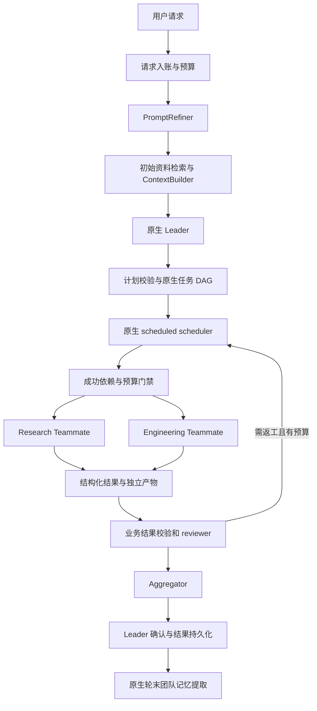

# JiuwenSwarm MVP 项目文档

版本：0.1 · 更新日期：2026-10-11（Asia/Shanghai）· 阶段：源码核对与设计完成，应用实现未开始。

本文件统一维护用户需求、工程决策、源码事实、运行流程、验收和变更记录。下一次更新前必须完整阅读本文件；新增或变更需求先记入本文，实施结束再更新实际结果。执行规则见 [AGENTS.md](AGENTS.md)。

## 1. 目标与当前状态

项目目标：基于 OpenJiuwen/JiuwenSwarm 构建可多 Agent 协作的复合型 Agent。它保留用户原始意图，先完善任务说明，再规划和分工；成员按专业角色使用 Skill、模型和工具，检索资料、管理上下文，最后形成可追溯的交付结果。

MVP 固定一个 Leader 和两个专业 Teammate（Research、Engineering）。提示词改进、上下文组装、混合检索、结果汇总是业务模块，可按需调用模型，不额外占用常驻团队成员名额。动态扩缩容与自适应模型选择属于后续目标。

| 项目项 | 当前状态 |
|---|---|
| 官方 JiuwenSwarm 源码 | 已拉取，固定到 `3fea8d1623a13646e935df9e96100ab7ad470aa4` |
| 官方 agent-core 源码 | 已拉取并切换到 Swarm 锁定的 `6df9699e650b3ad9b9835b46ae3c3b7572adb04b` |
| 源码接口核对 | 已完成 MVP 相关路径核对；不是全仓库审计 |
| 行为探针 | 7 项通过，包含 5 项隔离函数执行与 2 项静态检查 |
| 原对话中的 adaptive_composite_agent | 只有历史对话报告；未取得当时沙箱代码，不能据此宣称本地实现完成 |
| 应用代码、真实模型、真实 RAG、恢复测试 | 未实现/未执行 |

源码位置：`upstream/jiuwenswarm/`、`upstream/agent-core/`。版本机器记录见 [source-lock.json](source-lock.json)。当前 Swarm 包名为 `workswarm`，源码包为 `jiuwenswarm`，Python 要求 `>=3.11,<3.14`。拉取时介绍视频的 Git LFS 对象返回 404；已跳过媒体下载恢复完整源码检出，两个参考 checkout 均无本地代码变更。视频不属于本次核对范围。

## 2. 用户需求登记

来源：用户引用的《拉取分析OpenJiuwen框架》《设计JiuwenSwarm MVP》及当前会话。历史方案中的细节作为设计输入，不自动视为已验证事实。

| 编号 | 需求 | 优先级/阶段 | 验收标准 | 当前状态 |
|---|---|---|---|---|
| R01 | 使用 OpenJiuwen/JiuwenSwarm，实现多 Agent 协作 | MVP | 一个请求经 Leader 和专业成员完成 | 已设计，未实现 |
| R02 | 保留一个 Leader、两个固定专业 Teammate | MVP | 名册为 3 个协作成员，执行中不能自行新增 | 已确认原生机制 |
| R03 | 依据 Skill 改进提示词，减少歧义和无证据推断 | MVP | 原始请求不变；约束、验收、假设、未知项分开保存 | 已设计 |
| R04 | 项目规划、任务分配、依赖和必要并行 | MVP | 计划无环、依赖存在、角色有效；依赖产物通过校验才执行 | 已设计 |
| R05 | 不同成员使用对应 Skill | MVP | 专业可见性可检查；Skill 有版本或内容 hash；工具另行限制 | 已设计 |
| R06 | 上下文裁剪/摘要和压缩召回 | MVP | 长上下文仍保留硬约束和工具配对；原文可回查；模型输入不超限 | 已核对、待集成 |
| R07 | 知识资料 RAG 与混合检索 | MVP | 授权资料可检索、引用可回查；embedding 失效可退回关键词 | 已设计 |
| R08 | 最终结果汇总、覆盖检查与证据冲突处理 | MVP | 输出完整/部分/失败状态；未验证结论不标为事实 | 已设计 |
| R09 | 按角色选用匹配模型、自主调用配置的 API | MVP 基础配置；后续自适应 | 基础版角色模型可配置；记录真实调用与用量 | 已确认模型接口 |
| R10 | 根据问题规模调整 Agent 数量 | 后续 | 按可并行任务、预算、限流决定；缩容先 draining | 已保留边界，MVP 不启用 |
| R11 | 失败回退、局部返工、预算与恢复 | MVP | 故障注入可交付明确部分结果；恢复不误重放副作用 | 已设计，尚未验证 |
| R12 | 团队长期记忆、成员个人记忆和当前上下文分离 | MVP | 成员私有记忆隔离；团队提取只走框架轮末路径 | 已核对 |
| R13 | 核对源码后完善设计，不先开发整个应用 | 当前阶段 | 版本、真实接口、差异、限制均有源码证据 | 本次完成 |
| R14 | 项目文档放入所有需求和流程；下次更新前阅读并更新 | 持续要求 | PROJECT.md 为唯一维护入口，AGENTS.md 写入规则 | 本次完成 |

提示词改进只能减少歧义；降低幻觉还依赖真实检索、引用核验、工具结果记录和验收。任何模型评分都不替代这些检查。

## 3. 源码核对与原方案修正

下列事实仅适用于 source-lock.json 中的提交。Sxx 的固定源码链接见第 14 节。

| 项目 | 核对结论 | 设计影响 | 证据 |
|---|---|---|---|
| 版本兼容 | Swarm 指定 agent-core 提交，不能用最新版推测接口 | 版本锁定、升级先做兼容检查 | S01 |
| 团队入口 | `TeamAgentSpec` 与 `Runner.run_agent_team_streaming` 存在；Runner 默认接 Spec 或已激活 team_name | RuntimeAdapter 首次传 Spec，不先 build 实例再交 Runner；不使用已删除的 factory | S02、S03 |
| 固定成员 | `team_mode="predefined"` 限定名册；默认有预定义成员时仍可能为 hybrid | 必须显式 predefined；移除动态 spawn 路径 | S02 |
| 定向调度 | `dispatch_mode="scheduled"` 使用原生 scheduler；与自主 claim 模式不同 | MVP 采用 scheduled，不自建第二个任务调度器 | S02、S04 |
| 角色与模板 | `agents` 按框架 role 查找；Research/Engineering 都是 `teammate` | 在 predefined_members 的 `desc/prompt` 和可见性元数据区分专业；不能靠 `agents.research` 自动分配 | S02、S05、S06 |
| 人设字段 | 核心成员身份使用公开 `desc`、私有 `prompt` | 不只写旧 `persona`；配置编译后检查最终 Spec | S05 |
| DAG | `TeamTaskManager.add_graph` 批量原子创建、检查依赖、刷新 blocked 状态 | 通过任务工具/适配层提交图，不直接写任务表 | S04 |
| 验收开关 | `enable_task_verification` 仅影响提示词，不保证任务拥有 reviewer | 业务计划验证必须要求关键任务带 reviewer，完成还须有有效产物 | S02、S04 |
| 取消依赖 | completed 和 cancelled 都会把依赖边置为 resolved | 依赖解除不代表业务成功；执行前用成功产物门禁 | S07、P06 |
| 应用记忆 | Swarm 本地 manager 缺 key 时产生非零 mock 向量；向量故障后仍用混合权重和阈值 | 不用于 MVP 团队记忆路径；普通应用路径另加真实 provider 检查 | S08、P01、P03 |
| 团队个人记忆 | 团队 MemberMemoryToolkit 使用 core.memory.lite；无 embedding 时走关键词分支、独立阈值 | 团队记忆适配使用这条路径，不复用应用 manager 的 camelCase 参数 | S09、P02 |
| embedding 配置 | core 环境变量是 `EMBEDDING_API_KEY/BASE_URL/MODEL_NAME`；Swarm 模板另有 `EMBED_API_KEY/API_BASE/MODEL` | 配置层显式构造 EmbeddingConfig 传 TeamMemoryConfig；不假设环境变量自动互通 | S09 |
| 团队共享记忆 | SharedMemoryManager 读取 TEAM_MEMORY.md；轮末 extractor 写；它不是任意上传文件的 RAG 索引 | 作为受限上下文注入，知识资料另建索引；不重复提取 | S10 |
| 压缩器版本 | Harness 的 preset 激活 forked 压缩器，同名的传统 core 压缩器仍存在 | 按实际 Rail 的 forked 配置接入，避免同名 API 混用 | S11、P07 |
| 压缩字段 | forked 的 `min_target_context_ratio` 是可压缩片段大小下限，不是压缩到某个窗口比例 | 不承诺“达到75%必压至55%”；压缩后重新计数 | S11、P07 |
| RAG 接口 | `SimpleKnowledgeBase.add_documents/retrieve` 存在；需 chunker/indexer/store 或自定义 retriever | 明确资料导入和查询两条链；不是创建类即有完整知识库 | S12 |
| RAG 权限 | hybrid/vector/sparse 检索器调用 store 时传 `filters=None` | 不能依赖 RetrievalConfig.filters 隔离资料；先选授权 collection，再查 | S13、P04 |
| Chroma 稀疏路径 | sparse_search 使用 `collection.query(query_texts=...)`，源码也注明非直接 BM25 | MVP 关键词使用可验证的 SQLite FTS5 BM25；不把 Chroma query_texts 当 BM25 | S14 |
| Skill 可见性 | allow 并集、deny 并集；有效 allow 为空继承库；元数据损坏可退回宽松默认；配置只初始化元数据 | 所有专业成员显式非空 allow；启动验证有效集合；可见性不等于文件/工具权限 | S15、P05 |
| Swarmflow | 使用独立的一次性 worker 生命周期与并发/预算体系 | 暂不与常驻 Teammate 的任务看板混合；后续单独评估 | S16 |

### 重要限制

源码中的 CAS 状态转换不等于应用自定义 `attempt` 的完整隔离。旧结果与重新执行可能处于同一个 in_progress 状态，应用仍需给产物和结果提交增加 execution_id 校验。框架任务表和应用运行表不是天然跨库原子事务；事件发布也不能假定已经实现可靠 outbox。恢复必须对账，而不能仅重放事件。

## 4. 架构决策与职责

| 决策 | 内容 | 原因 |
|---|---|---|
| D01 | 依赖版本固定；MVP 通过薄适配层集成 JiuwenSwarm 的团队配置与 core 团队运行时 | 避免 develop 漂移 |
| D02 | 3 个协作成员、inprocess、persistent、SQLite、predefined、scheduled | 满足固定 MVP 并复用原生调度 |
| D03 | 暂不开启 Swarmflow、额外 subagent、动态 spawn、Skill 自动演进 | 保持可调试的执行路径；这些能力仍保留为后续目标 |
| D04 | 原生任务表是任务调度唯一权威；应用表只保存运行元数据、证据、产物和事件投影 | 避免双调度与双状态冲突 |
| D05 | 业务计划、结果验收与成功依赖门禁是确定性校验 | 不把完成声明当作验收通过 |
| D06 | 资料 RAG 用独立逻辑索引；小规模首版选择 SQLite FTS5 + 真实 embedding 向量排名 + RRF | 权限和 BM25 行为可验证，避免 store 差异 |
| D07 | 原生上下文 Rail 处理历史压缩；ContextBuilder 负责当前任务和证据预算 | 不给同一段历史重复做两套摘要 |
| D08 | 角色模型先静态配置；质量、延迟和成本指标稳定后再启用自适应路由 | 保留用户长期目标，先形成可评估基线 |



两个专业成员可以执行多个任务；队列任务数不等于 Agent 数。Research 提供证据和未知项；Engineering 给出架构、接口、实现建议和可执行验证。Leader 负责计划、分配、冲突处理和最终判断。Aggregator 负责结构整理和覆盖报告，不能擅自把冲突“消解”为确定事实。

## 5. 数据与存储约定

下列是应用层模型设计，不是框架已有 SDK 类型。实际实现使用 Pydantic v2；配置和业务输入采用 extra="forbid"，避免未知参数被静默忽略。

| 对象 | 关键字段 |
|---|---|
| RunRequest | run_id, session_id, user_id, project_id, original_prompt, source_refs, submitted_at, deadline_at, budget |
| TaskSpec | original_prompt_hash, goal, constraints, acceptance[id,text], assumptions, unresolved_questions, required_capabilities |
| TaskPlan | plan_id, revision, tasks[id,role,instruction,acceptance_ids,depends_on,requires_success,reviewers], source_refs |
| TaskBinding | run_id, plan_revision, app_task_id, framework_task_id, member_id, execution_id, execution_seq |
| Evidence | evidence_id, corpus, source_uri, source_revision, doc_id, chunk_id, content_hash, locator, text, retrieval_method, raw_score, fused_rank, access_scope |
| ContextBundle | spec_ref, task_ref, pinned_constraints, decision_refs, evidence_refs, recent_messages, compressed_history_ref, input_token_estimate, tokenizer_id |
| TaskResult | task_id, execution_id, outcome[success/partial/error], claims[text,kind,evidence_ids], artifact_refs, acceptance_checks, unresolved, error |
| Artifact | artifact_id, run_id, task_id, execution_id, path, hash, media_type, created_at |
| AcceptanceCheck | acceptance_id, result[pass/fail/unknown], verifier, evidence_refs, diagnostic |
| RunEvent | event_id, seq, run_id, session_id, framework_event_ref, type, payload_ref, observed_at |
| FinalResult | run_id, outcome[complete/partial/failed/cancelled], answer, acceptance_checks, evidence_refs, artifact_refs, limitations, usage |
| Budget | max_model_calls, max_tokens, deadline_at, spent, reserved, finalization_reserve, usage_quality[provider/estimated/unknown] |

原生任务状态按框架展示：pending、blocked、planning、in_progress、in_review、completed、cancelled。应用不得把自定义 failed/succeeded 状态直接写入原生表。应用 `outcome` 记录业务结果，即使 framework_task 已 completed，也必须经过 AcceptanceCheck 才能视为业务成功。

运行状态、知识、长期记忆分别保存：

```text
project-data/
├── runs.sqlite                    # 请求、预算、结果、绑定、事件投影
├── knowledge/<project>/<scope>/    # 授权语料和独立 FTS/vector 索引
│   ├── corpus.sqlite
│   └── sources/                    # 原始资料及版本/hash
└── runs/<run_id>/tasks/<task_id>/<execution_id>/
    ├── result.json
    └── artifacts/                  # 不可变产物，不覆盖旧执行
```

原生团队任务/消息/会话 checkpoint 保持框架拥有。个人记忆由当前成员读取、写入；共享 TEAM_MEMORY.md 由框架 extractor 更新。它记录团队决策/经验，不替代当前运行账本或资料源。团队记忆作为稳定背景，事实仍回查原资料。

事件消费采用去重投影：同一框架事件重复到达不重复登记；框架没稳定 event_id 的事件，使用已知实体标识和转换数据形成去重键，不能按接收时间生成“唯一新事件”。定期/恢复时读取原生任务快照重建投影，处理丢失事件。MVP 同一个 team_name/session 同时只承载一个业务 run；跨会话并行采用独立 team_name，避免原生 pool 的 team_name 单 Leader 语义冲突。

## 6. 完整执行流程

1. **请求入账**：生成 run_id、绑定 session/team；保存原始请求及 hash；设定预算与截止时间。资料作为输入数据，不成为系统指令。
2. **提示词改进**：PromptRefiner 使用选定的提示词工程 Skill 内容，生成 TaskSpec。推测只写 assumptions，不补造用户目标。必须问题缺失时进入 needs_input，允许继续的未知项明确保留。
3. **初始检索**：只访问该身份授权的资料 scope；读取本团队共享记忆与 Leader 自身个人记忆。Leader 不统一搜索全成员私有记忆。
4. **Leader 规划**：产出结构化 TaskPlan；Validator 检查 DAG、身份、角色、依赖引用、验收覆盖、预算和 reviewer。无效计划修复一次，仍失败使用最小固定模板。
5. **创建原生任务**：RuntimeAdapter 将计划映射到原生 create_task 批量工具/TeamTaskManager.add_graph 的内部桥接；用原生 scheduler 启动成员，不另建 claim/lease 循环。
6. **执行前门禁**：TaskInputRail/工具桥接在任何子任务业务模型或工具执行前读取前置 TaskResult；需要成功的边须有当前 execution 的有效产物。失败边进入应用 dependency_failed，交回 Leader 调整/取消子图，不能因 framework resolved 而继续。
7. **子任务检索与上下文组装**：定向检索；固定目标、硬约束、验收、当前任务和必要证据；历史交给原生 ContextProcessorRail。任务输入和引用带版本。
8. **专业成员执行**：使用当前成员的显式 Skill 集合、模型和工具范围。模型/工具调用留记录，产物写入该 execution 独立目录。
9. **提交结果**：新增 submit_task_result 工具校验 JSON、引用、产物 hash 与 execution_id，保存不可变结果。只有当前 execution 可以触发 member_complete_task；绕过提交工具的完成请求由 CompletionGateRail 拦截。
10. **验收与返工**：关键任务设置 reviewer；reviewer 不能是作者。结构性验收由程序完成，语义评价由 reviewer/Leader 完成。最多一次业务返工，框架内部重试也计入总预算。不能只依靠 enable_task_verification。
11. **汇总**：Aggregator 按 acceptance_id 合并有效成果，保留未解决冲突；Leader 确认。complete 必须所有必选条件 pass；否则返回 partial/failed 并列出缺失。
12. **最终交付与记忆**：先保存最终结果，再返回用户；框架轮末提取仍使用既有路径。应用观察提取结果，不在正常交付路径再调用第二次 extractor。提取失败不能撤销已保存结果。

依赖示例：Research 的“事实与框架能力”任务作为 Engineering 的“最终方案”前置；Engineering 的独立接口草案可以并行。最终方案依赖的是通过校验的事实产物，不是仅收到一条完成消息。

## 7. 上下文与检索流程

### 7.1 上下文管理

每个模型 profile 显式声明 context_window、max_output_tokens、tokenizer 和工具能力。输入预算 = context_window − 输出预留 − 安全余量，计入系统提示词、Skill、tool schema、历史及工具结果。没有可用 tokenizer 时使用保守估算并标记 estimated，不宣称精确计数。

ContextBuilder 保存不可压缩的当前目标、用户硬约束、验收及任务输入。历史只由原生 Rail 压缩；压缩后再次计算最终请求预算。若仍超限，缩小证据/历史完整交互单元；固定部分仍超限则报 context_limit，Leader 拆分任务。不能截断 tool_call/tool_result 配对。

MVP 显式启用 `react.context_engine_config.enabled` 和 compression_recall_config（原文归档访问限于本会话）。forked RoundLevelCompressor 的 trigger_context_ratio 可从 0.75 开始评测，keep_recent_messages 从 6 开始；这只是应用初始参数。`min_target_context_ratio` 保持可压缩片段下限语义，不写成“压缩到55%”。Dialog/CurrentRound/RoundLevel 的全链配置需一起检查；不只设置最后一个处理器便承诺整个链保留最近6条。

摘要必须保留来源消息/产物引用和未解决问题。原文与摘要的矛盾以新的原始记录和明确用户意图为准；摘要中的推断不能变为事实。摘要失败先用已有有效摘要/完整原文，并受输入预算约束。SessionMemoryCompressor 暂不额外启用，避免与应用任务记录和团队长期记忆叠加不清。

### 7.2 知识资料 RAG

导入链：授权检查 → 文件解析 → 资料版本/hash → 分块与 locator → FTS5 索引 → 可选真实 embedding → 索引状态 ready。解析/embedding 失败明确记录；词库可用而向量不可用时标记 keyword_only，不能把失败索引伪装为完成。

查询链：身份与 scope 验证 → 选择授权的独立 collection/数据库 → 关键词/向量召回 → 按 chunk_id+revision 去重 → RRF → 来源/版本确认 → token 裁剪 → Evidence。

RRF 为 `sum(1 / (60 + rank))`，rank 从 1 开始。每个来源内部已融合的结果不再当“两份召回”重复融合。知识与个人记忆的原始 score 不直接比较，也不是事实置信度。

首版资料关键词检索采用 FTS5 BM25。中文使用 trigram 等可验证 tokenizer；不足3字符的词和必要实体匹配采用受限的补充检索，记录具体方法，不将其冒称为 BM25。embedding 仅接受真实配置的 provider；维度、模型、内容 hash 组成缓存/索引签名，切换模型必须重建向量索引。

OpenJiuwen `SimpleKnowledgeBase` 是真实资料接口，可注入自定义 Retriever 接上述 FTS/向量实现。原生 retriever 的 filters 问题解决前，不以传一个 tenant_id filter 作为权限保障。授权在检索前决定可访问集合，检索后再校验 evidence access_scope；未经授权的 text 不进入模型、日志或缓存。

团队长期记忆：显式 TeamMemoryConfig(enabled=True, scenario="general", shared_memory=True, auto_extract=True)，构造正确 EmbeddingConfig；无 embedding 时 core lite 支持关键词回退。共享 TEAM_MEMORY.md 直接按团队权限读取并注入，MVP 不承诺共享摘要天然有 BM25/向量索引。顶层 memory.engine 与 core TeamMemoryConfig 是不同控制表面，配置编译要检查最终挂载结果。

## 8. 真实接口与应用适配边界

| 能力 | 核对到的真实表面 | 接入决策 |
|---|---|---|
| 团队配置 | `openjiuwen.agent_teams.TeamAgentSpec`、DeepAgentSpec、LeaderSpec、TeamMemberSpec | 编译为 validated Spec；保存去敏配置快照 |
| 运行 | `Runner.run_agent_team_streaming(agent_team=spec, inputs={"query": ...}, session=...)` | RuntimeAdapter 管理冷/热启动和流式结果 |
| 暂停/停止 | `Runner.pause_agent_team`、`Runner.stop_agent_team` | 仅由适配层调用；恢复结果须对账 |
| 图提交 | `TeamTaskManager.add_graph(list[TaskGraphSpec])`，原生 create_task 工具 | 属内部实现桥接，不承诺为稳定顶层 SDK；隔离在 adapter |
| 短模型模块 | `create_tiny_agent(...)` 与 `TinyAgent.run(content, schema=...)` | 用于 refiner/aggregator 的无状态调用；不形成额外常驻协作成员 |
| 知识库 | `SimpleKnowledgeBase.add_documents`、`.retrieve(query, config=RetrievalConfig(...))` | KnowledgeAdapter；返回值转换为 Evidence |
| 上下文 | `ContextProcessorRail(processors=..., preset=True)` | 配置 forked preset，ContextBuilder 只组装业务输入 |
| 团队记忆 | TeamMemoryConfig、MemberMemoryToolkit、SharedMemoryManager、轮末 extractor | 正常路径复用框架自动挂载和提取，不单独再造 writer |

应用接口设计（以下不是 SDK 既有接口）：

```python
class PromptRefiner:
    async def refine(self, request, skill_context, budget) -> TaskSpec: ...

class ContextBuilder:
    async def build(self, spec, task, evidence, artifact_refs, budget) -> ContextBundle: ...

class EvidenceRetriever:
    async def search(self, query, principal, authorized_scopes, budget) -> RetrievalBatch: ...

class PlanValidator:
    def validate(self, plan, spec, roster, budget) -> ValidationReport: ...

class ResultValidator:
    async def validate(self, result, binding, acceptance) -> ValidationReport: ...

class Aggregator:
    async def merge(self, spec, accepted_results, budget) -> FinalResult: ...

class RuntimeAdapter:
    async def run(self, run_request, compiled_spec) -> AsyncIterator[RunEvent]: ...
    async def snapshot(self, run_id) -> RuntimeSnapshot: ...
    async def pause(self, run_id) -> None: ...
    async def cancel(self, run_id) -> None: ...
    async def reconcile(self, run_id) -> RecoveryReport: ...

class RunRepository:
    async def register(self, request) -> None: ...
    async def submit_current_execution(self, binding, result, event) -> None: ...
    async def commit_final(self, final_result) -> None: ...
```

门禁 Rail/工具需新增并集成；它们不是本次已实现的能力。与原生工具的执行顺序、身份和完成状态测试是开发阶段 P0。组装前不得假定 `ContextProcessorRail` 已继承到所有成员或压缩成本已自动记账，需检查真实 runtime。

拟定对外接口：POST /runs、GET /runs/{id}、GET /runs/{id}/events（SSE）、POST /runs/{id}/cancel；needs_input 时增加 POST /runs/{id}/input。幂等键在 POST /runs 和副作用工具上使用；SSE 断线以 seq 续读应用事件投影，不触发重新执行。

## 9. Skill、模型与工具配置

Research/Engineering 使用同一个 teammate 运行模板和不同 private prompt。成员可见性元数据通过显式配置工具设置；成员 allow 分别设置 research/事实核查与 software_engineering/架构设计 Skill，team allow 仅列双方需要的公共 Skill。effective allow 和 deny 在启动时核验；不能用空 allow 表示禁用所有 Skill。

Skill 版本以来源 revision 或内容 hash 记录。自演进暂关闭，避免同一评测期间变化。修改配置不保证覆盖已有 visibility 文件，因此下一次 Skill 变更要同步显式元数据，而不是只改 YAML。Skill 的说明书不授予权限：文件读写、shell、外部 API 权限由工具配置和原生权限 Rail 独立控制。

MVP 模型配置：Leader 使用规划/推理 profile，Research 使用资料分析 profile，Engineering 使用工程 profile；Refiner/Aggregator 选择结构化输出可用的 profile。逻辑 profile 编译成真实 TeamModelConfig/模型池条目；需要按 model_name 固定分配时使用 by_model_name，默认 round_robin 不代表按复杂度择优。

API 配置由环境/配置层管理；模型只能选择已注册能力和端点。首次真实集成测试要核对每个 profile 的工具调用、结构化输出、tokenizer、上下文窗口和 usage 上报。budget 是应用统一账本，统计 Leader、成员、refiner、aggregator、压缩和记忆提取；不假设仅设置 swarmflow_budget 就覆盖这个未启用 Swarmflow 的 MVP。

## 10. 失败、取消与恢复

| 故障 | 行为 |
|---|---|
| Refiner 超时/格式无效 | 在总预算内修复一次；失败则用原始请求构造最小 spec，标记 degraded |
| 计划无效 | 修复一次；仍失败使用 research → engineering 的最小计划 |
| embedding 不可用 | 资料 RAG 回退真实关键词；明确 retrieval_mode/degraded_reason；核心团队记忆按已确认路径回退 |
| 检索为空 | 返回空 evidence 和不足说明；不得生成虚假引用 |
| 资料来源失效/版本不符 | 去掉该证据并补查；无法补查标记 unknown |
| 压缩失败/仍超窗口 | 保留有效记录，减少完整交互/资料；固定内容超限则拆分子任务 |
| 模型暂时失败 | 有限退避；框架内部重试也算在总调用/时间预算中，禁止叠乘失控 |
| 成员最终失败 | 无效结果不能完成验收；禁止失败前置的成功依赖任务开始业务执行；独立任务可继续 |
| 结果无效/证据冲突 | 最多一次定向返工；冲突仍存在则标记 partial/unknown |
| Aggregator 失败 | 以通过校验的 TaskResult 做确定性模板汇总 |
| 用户取消 | 先写 cancelling 和停止准入，再停止原生运行；冻结本 run 产物；忽略迟到 execution 的完成 |
| 进程中断 | 以同一锁定 Spec 和持久 session 恢复；对账原生任务、checkpoint、应用 execution/产物；不盲目重新派发 |
| 外部副作用状态未知 | 不自动重放；使用幂等键和工具执行记录，必要时 needs_reconciliation |
| 团队记忆提取失败 | 已交付结果保留；记录可观察诊断。若需应用自动重试，另做幂等/单 writer 设计，不声称已有保证 |

统一 BudgetManager 在调用前原子预留，返回后结算，失败释放预留并记录。为最终汇总保留预算；并发预留避免两个成员同时花完余额。没有 provider usage 的调用不记“0成本成功”，明确 unknown/estimated。达到 deadline/max_calls/max_tokens 后停止新工作并用已有成果交付 partial；记忆提取也须受独立余量约束。

## 11. 动态扩缩容与自适应路由边界

未来任务仍按 capability/role 提需求，RosterAdapter 再映射成员，而不是在业务需求里写死 research_member。未来启用 hybrid roster 时加入 ScalingPolicy、MemberLifecycleAdapter、ModelPolicy：

```text
ScalingPolicy.decide(queue_depth, parallel_ready_tasks, member_health,
                     remaining_budget, provider_limits) -> ScalingDecision
MemberLifecycleAdapter.spawn(spec) / drain(member_id) / shutdown(member_id)
ModelPolicy.select(task, complexity, evidence_quality, budget) -> ModelProfile
```

扩容触发依据队列压力、独立 ready 子任务和剩余预算；成员数量硬上限；串行依赖链不因长提示词而扩容。缩容先 draining，不接新任务，等待当前 execution 结束再退出。新成员只拿当前任务、授权证据、必要摘要和共享团队记忆，不复制其他成员私有记忆。

原生 model_pool/router/intelli_router 是模型配置/分配/可靠性机制，不能直接宣称它们已经实现业务复杂度路由。先用相同评测集比较静态与自适应策略，再决定扩容、模型升级或降级。Swarmflow 若后续用于固定阶段流水线，另做 worker 与 Teammate 的生命周期、预算、恢复桥接方案，不共享双重调度权威。

## 12. 实施顺序与验收计划

| 阶段 | 内容 | 退出条件 |
|---|---|---|
| P0-A | 最小版本环境、Spec 编译、固定成员、模型/Skill/权限检查 | 不调用真实模型也能校验配置与名册；禁止动态 spawn |
| P0-B | RuntimeAdapter、Plan/Completion/Dependency gates、RunRepository | 取消前置不导致下游业务执行；旧 execution 不能完成新任务；坏结果不能完成 |
| P0-C | Refiner、资料导入、FTS5/RRF、Evidence、ContextBuilder | 中文资料可检索；无 embedding 有真实关键词；跨 scope 不泄露 |
| P0-D | Aggregator、语义验收、统一预算、事件投影 | 一个模拟端到端请求按验收产出；断连不重复执行；有限返工 |
| P1 | 真实模型、embedding、长期记忆、压缩与重启恢复 | 真实工具/RAG/压缩召回/恢复集成测试通过，成本可追踪 |
| P2 | 动态成员数量、模型策略、更多角色/工具 | 与固定基线对比收益，成员硬上限和 draining 通过 |

必须的验收场景：

1. 一个含 research → engineering 依赖的请求从原始输入到带证据交付；所有必选 acceptance 通过。
2. 可独立任务并行，依赖任务等待有效产物；固定3名协作成员保持不变。
3. embedding 缺失、超时或故障时，已知关键词仍能找到真实资料，返回 keyword_only。
4. 不同项目/身份 scope 相同关键字查询，不出现未授权 evidence，原文不进入模型输入。
5. cancelled 前置不能被视为 success；下游允许解除原生 blocked，但业务门禁阻止实际执行。
6. 缺 reviewer 的关键任务不能被计划验证器接受；不合格结果不会直接 member_complete。
7. 超长工具链保持配对，固定约束仍在，召回能访问原始消息；最终模型请求在 profile 窗口内。
8. 重启、重复事件、晚到结果下，对账保留已接受成果，不重放外部副作用，不跨 execution 覆盖。
9. 预算计入所有模型调用，包含模块和压缩；超限停止新工作，并交付有边界的 partial。
10. 团队记忆单 writer、成员私有记忆隔离；提取失败不撤销结果。

评价指标：任务验收通过率、引用支撑率、冲突/返工次数、关键词与混合 Recall@k、跨 scope 泄漏数、平均/尾部延迟、总 tokens/calls、恢复重复执行次数。先建立固定角色基线，再比较模型/人数自适应。

## 13. 本次验证记录与下一次待办

已执行：官方源码拉取、提交核对、相关类型/调用链/测试源码阅读；[source_probes.py](probes/source_probes.py) 7 项通过，详见 [results.json](probes/results.json)。脚本只提取源码函数并使用 stub，另做两项 AST/文本检查；没有导入完整 SDK、安装依赖、调用 API 或执行官方完整测试套件。文档校验确认14项需求、30个固定源码链接均对应本地文件，两个参考 checkout 提交与锁文件一致且无本地变更。

复现命令（本机 bundled Python）：

```powershell
& 'C:\Users\19468\.cache\codex-runtimes\codex-primary-runtime\dependencies\python\python.exe' probes/source_probes.py
```

本机 py launcher 指向已不存在的 `D:\Development\Python\python.exe`，本次改用 bundled Python，不修改系统 Python 配置。

下一次更新先阅读本文，优先做 P0-A/P0-B 的最小集成验证，再扩业务模块。尚需确认的技术问题：

- CompletionGate/TaskInputRail 在 scheduled 自动交接中的挂载和身份顺序，是否能在第一次业务执行前可靠拦截；不能只靠 prompt。
- JiuwenSwarm 模板配置、原生 Spec 与团队 core memory 的实际挂载差异；最终有效配置必须检查。
- 团队 checkpoint 和应用结果落盘的恢复一致性、取消/重启竞态、坏结果 completion 拦截。
- 中文 FTS5 tokenizer 的本地可用性和实体词回退策略；真实 embedding 模型维度与 Recall@k。
- 所有成员及压缩/提取的调用预算覆盖；SDK内部调用观测与用量缺失处理。
- 真实 API 的工具/结构化输出能力、限流和 timeout。无凭据前不能声称这部分已通过。

## 14. 源码证据索引

固定提交链接优先于 develop 链接。Sxx 是本文事实来源，不是待实现模块。

- S01：[JiuwenSwarm pyproject.toml](https://github.com/openJiuwen-ai/jiuwenswarm/blob/3fea8d1623a13646e935df9e96100ab7ad470aa4/pyproject.toml)。
- S02：[TeamAgentSpec/LeaderSpec/TinyAgentSpec](https://github.com/openJiuwen-ai/agent-core/blob/6df9699e650b3ad9b9835b46ae3c3b7572adb04b/openjiuwen/agent_teams/schema/blueprint.py)。
- S03：[Runner 团队 facade](https://github.com/openJiuwen-ai/agent-core/blob/6df9699e650b3ad9b9835b46ae3c3b7572adb04b/openjiuwen/core/runner/team_runner.py)。
- S04：[TeamTaskManager](https://github.com/openJiuwen-ai/agent-core/blob/6df9699e650b3ad9b9835b46ae3c3b7572adb04b/openjiuwen/agent_teams/tools/task_manager.py)、[TaskGraphSpec](https://github.com/openJiuwen-ai/agent-core/blob/6df9699e650b3ad9b9835b46ae3c3b7572adb04b/openjiuwen/agent_teams/schema/task.py)。
- S05：[MemberSpecBase/TeamMemberSpec](https://github.com/openJiuwen-ai/agent-core/blob/6df9699e650b3ad9b9835b46ae3c3b7572adb04b/openjiuwen/agent_teams/schema/team.py)。
- S06：[成员模板选择 TeamAgent](https://github.com/openJiuwen-ai/agent-core/blob/6df9699e650b3ad9b9835b46ae3c3b7572adb04b/openjiuwen/agent_teams/agent/team_agent.py)、[DeepAgentSpec](https://github.com/openJiuwen-ai/agent-core/blob/6df9699e650b3ad9b9835b46ae3c3b7572adb04b/openjiuwen/harness/schema/deep_agent_spec.py)。
- S07：[task_dao 终止与依赖解除](https://github.com/openJiuwen-ai/agent-core/blob/6df9699e650b3ad9b9835b46ae3c3b7572adb04b/openjiuwen/agent_teams/tools/database/task_dao.py)、[原生 TaskStatus](https://github.com/openJiuwen-ai/agent-core/blob/6df9699e650b3ad9b9835b46ae3c3b7572adb04b/openjiuwen/agent_teams/schema/status.py)。
- S08：[Swarm 应用 embedding provider](https://github.com/openJiuwen-ai/jiuwenswarm/blob/3fea8d1623a13646e935df9e96100ab7ad470aa4/jiuwenswarm/agents/harness/common/memory/embeddings.py)、[应用 memory manager](https://github.com/openJiuwen-ai/jiuwenswarm/blob/3fea8d1623a13646e935df9e96100ab7ad470aa4/jiuwenswarm/agents/harness/common/memory/manager.py)。
- S09：[团队 MemberMemoryToolkit](https://github.com/openJiuwen-ai/agent-core/blob/6df9699e650b3ad9b9835b46ae3c3b7572adb04b/openjiuwen/agent_teams/memory/member_memory_toolkit.py)、[core lite manager](https://github.com/openJiuwen-ai/agent-core/blob/6df9699e650b3ad9b9835b46ae3c3b7572adb04b/openjiuwen/core/memory/lite/manager.py)、[core embedding 配置](https://github.com/openJiuwen-ai/agent-core/blob/6df9699e650b3ad9b9835b46ae3c3b7572adb04b/openjiuwen/core/memory/lite/embeddings.py)。
- S10：[TeamMemoryConfig](https://github.com/openJiuwen-ai/agent-core/blob/6df9699e650b3ad9b9835b46ae3c3b7572adb04b/openjiuwen/agent_teams/memory/config.py)、[TeamMemoryManager](https://github.com/openJiuwen-ai/agent-core/blob/6df9699e650b3ad9b9835b46ae3c3b7572adb04b/openjiuwen/agent_teams/memory/manager.py)、[SharedMemoryManager](https://github.com/openJiuwen-ai/agent-core/blob/6df9699e650b3ad9b9835b46ae3c3b7572adb04b/openjiuwen/agent_teams/memory/shared_memory.py)。
- S11：[ContextProcessorRail](https://github.com/openJiuwen-ai/agent-core/blob/6df9699e650b3ad9b9835b46ae3c3b7572adb04b/openjiuwen/harness/rails/context_engineer/context_processor_rail.py)、[forked 压缩基类](https://github.com/openJiuwen-ai/agent-core/blob/6df9699e650b3ad9b9835b46ae3c3b7572adb04b/openjiuwen/core/context_engine/processor/forked/compressor/base.py)、[forked RoundLevelCompressor](https://github.com/openJiuwen-ai/agent-core/blob/6df9699e650b3ad9b9835b46ae3c3b7572adb04b/openjiuwen/core/context_engine/processor/forked/compressor/round_level_compressor.py)。
- S12：[SimpleKnowledgeBase](https://github.com/openJiuwen-ai/agent-core/blob/6df9699e650b3ad9b9835b46ae3c3b7572adb04b/openjiuwen/core/retrieval/simple_knowledge_base.py)、[RetrievalConfig](https://github.com/openJiuwen-ai/agent-core/blob/6df9699e650b3ad9b9835b46ae3c3b7572adb04b/openjiuwen/core/retrieval/common/config.py)。
- S13：[HybridRetriever](https://github.com/openJiuwen-ai/agent-core/blob/6df9699e650b3ad9b9835b46ae3c3b7572adb04b/openjiuwen/core/retrieval/retriever/hybrid_retriever.py)（VectorRetriever/SparseRetriever 同目录也有 filters=None）。
- S14：[ChromaVectorStore](https://github.com/openJiuwen-ai/agent-core/blob/6df9699e650b3ad9b9835b46ae3c3b7572adb04b/openjiuwen/core/retrieval/vector_store/chroma_store.py)。
- S15：[Skill 可见性](https://github.com/openJiuwen-ai/agent-core/blob/6df9699e650b3ad9b9835b46ae3c3b7572adb04b/openjiuwen/agent_teams/skill/visibility.py)。
- S16：[Swarmflow 工程规则](https://github.com/openJiuwen-ai/agent-core/blob/6df9699e650b3ad9b9835b46ae3c3b7572adb04b/openjiuwen/agent_teams/workflow/AGENTS.md)。
- 辅助：[Swarm Team config loader](https://github.com/openJiuwen-ai/jiuwenswarm/blob/3fea8d1623a13646e935df9e96100ab7ad470aa4/jiuwenswarm/agents/harness/team/config_loader.py)、[Swarm 默认配置](https://github.com/openJiuwen-ai/jiuwenswarm/blob/3fea8d1623a13646e935df9e96100ab7ad470aa4/jiuwenswarm/resources/config.yaml)、[TinyAgent](https://github.com/openJiuwen-ai/agent-core/blob/6df9699e650b3ad9b9835b46ae3c3b7572adb04b/openjiuwen/agent_teams/tiny_agent.py)。

## 15. 变更记录

| 日期 | 版本 | 对应需求 | 更新内容 | 验证与限制 |
|---|---|---|---|---|
| 2026-10-11 | 0.1 | R01–R14 | 建立统一项目文档及更新规则；拉取并锁定官方源码；修正角色模板、调度、验收、取消依赖、RAG过滤、压缩字段与两条记忆路径；完善 MVP 流程与扩展边界 | 7项源码探针通过；未安装完整依赖、未运行真实模型/端到端；业务实现未开始 |

后续每次更新填写：需求编号、问题/变更理由、最终实现、实际执行的验证、仍未解决问题。若设计被实现取代，修改正文中的当前决策和状态，不只在此追加一句“已完成”。
